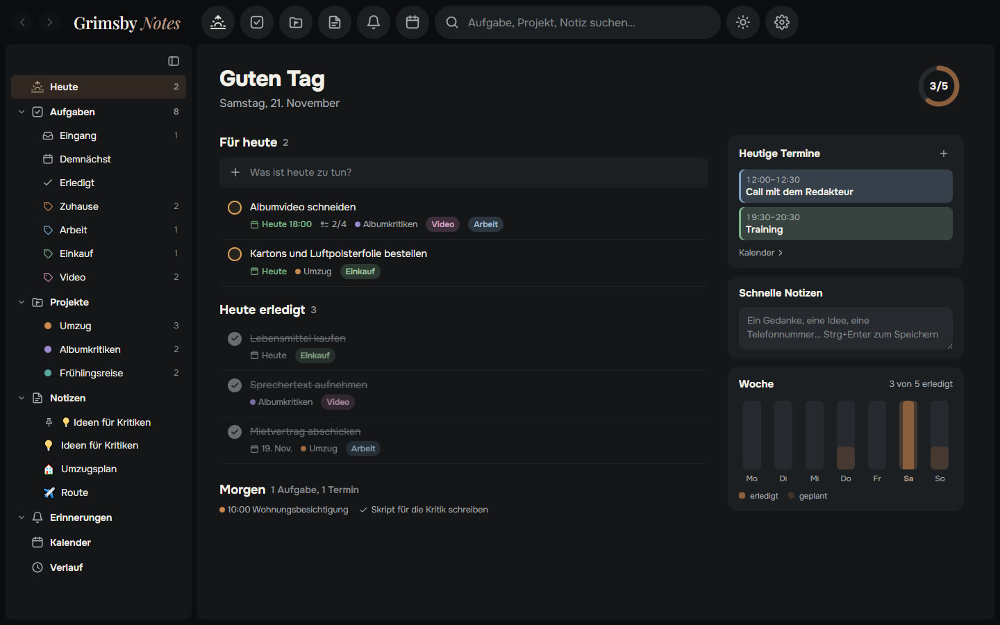
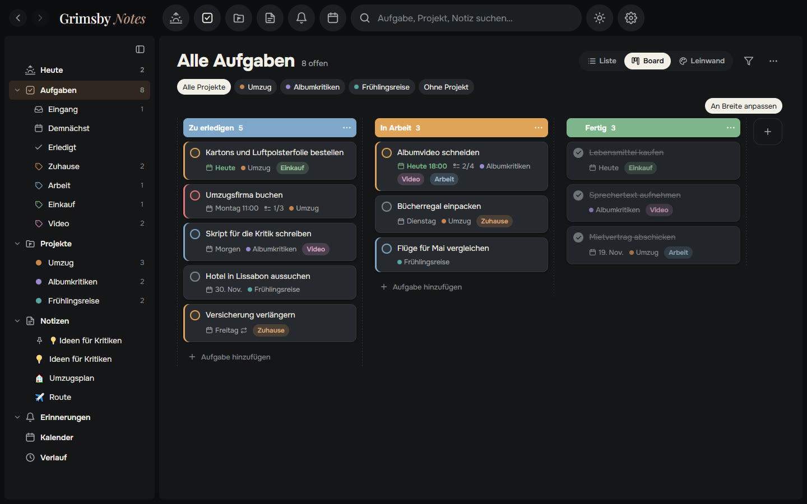
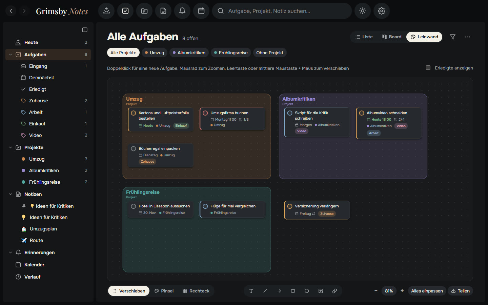
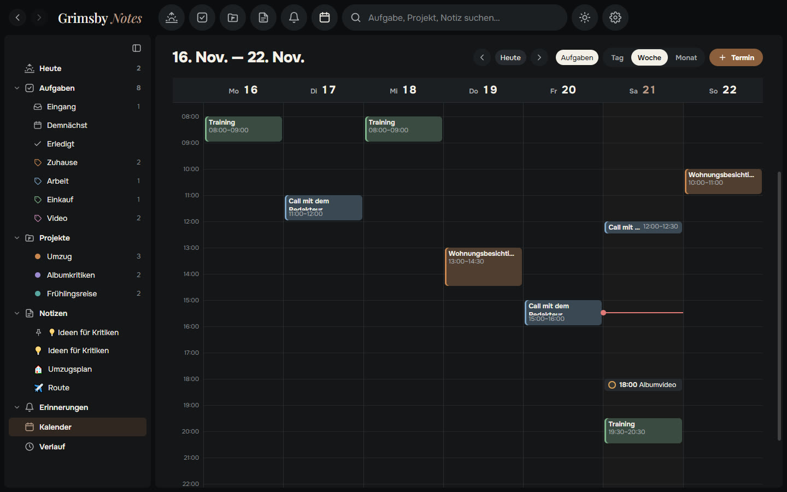
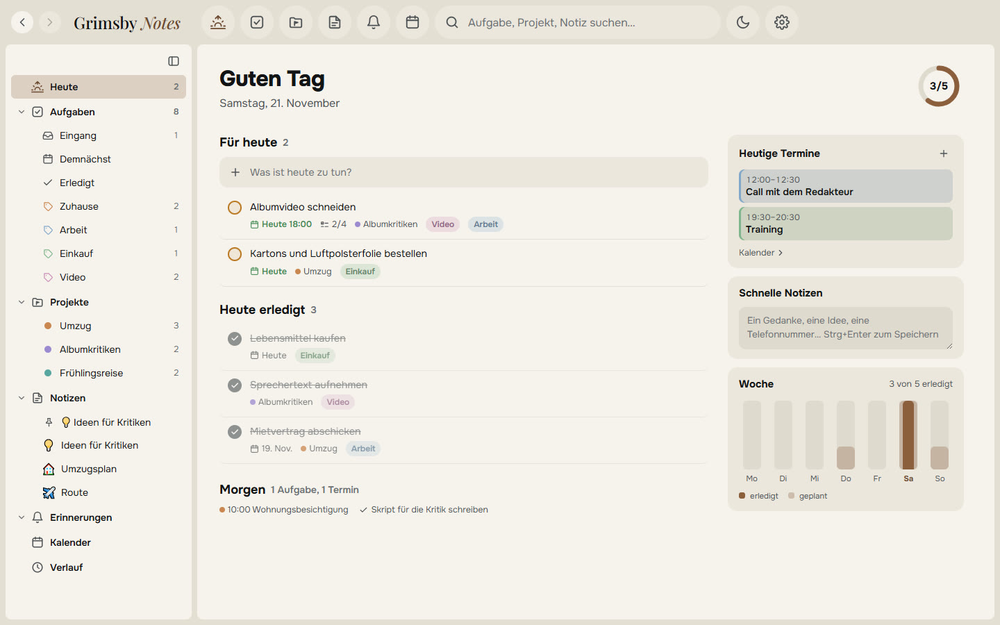

  <a href="README.md">English</a> ·
  <a href="README.ru.md">Русский</a> ·
  <a href="README.es.md">Español</a> ·
  <a href="README.pt.md">Português</a> ·
  <b>Deutsch</b> ·
  <a href="README.fr.md">Français</a> ·
  <a href="README.zh.md">中文</a> ·
  <a href="README.ja.md">日本語</a> ·
  <a href="README.ko.md">한국어</a>

  

  <b>Ein persönlicher Planer für Windows: Aufgaben, Projekte, Notizen und Kalender in einem Fenster.</b> 
  Alles bleibt auf deinem Computer: Aufgaben als Liste, Board oder auf einer freien Leinwand, Projekte mit Zielen, verknüpfte Notizen und Erinnerungen mit Windows-Benachrichtigungen.

  
  
  
  
  

  <a href="https://github.com/maksimkhatskevich/grimsby-notes/releases/latest"><b>⬇ Für Windows herunterladen</b></a>
  &nbsp;·&nbsp;
  <a href="#funktionen">Funktionen</a>
  &nbsp;·&nbsp;
  <a href="#datenschutz">Datenschutz</a>
  &nbsp;·&nbsp;
  <a href="#feedback">Feedback</a>

---

## Warum Grimsby Notes

Aufgaben in einer App, Notizen in einer anderen, der Kalender in einer dritten – und die Hälfte will ein Konto und Internet. Ein einfacher Tagesplan verteilt sich über mehrere Dienste.

**Grimsby Notes hält alles zusammen und zu Hause.** Ein Fenster, eine Datenbankdatei auf deinem Computer, keine Konten. Öffne **Heute** und sieh, was fällig ist, was geplant ist und was schon erledigt ist.

---

## Funktionen

### ☀️ Heute

Überfällige und geplante Aufgaben, Termine des Tages, Schnellnotizen und ein Fortschrittsring für die Woche. Eine Aufgabe direkt dort in einer Zeile hinzufügen: Datum wie 25.12, Uhrzeit, !Priorität, #Tags und @Projekt werden beim Tippen erkannt.

### ✅ Aufgaben: Liste und Board

Eingang, demnächst und erledigt, Filter und gespeicherte Ansichten. Ein Board mit eigenen Spalten und Farben. Jede Aufgabe hat Datum und Uhrzeit, Priorität, Tags, Checkliste, Beschreibung, Anhänge mit Foto- und Videovorschau, Wiederholungen und Erinnerungen. Eine Aufgabe kann zu mehreren Projekten gehören.

### 🎨 Leinwand

Eine freie Fläche, auf der Aufgaben nach Projektbereichen liegen: Karte in einen Bereich ziehen – sie gehört zum Projekt; dort ablegen, wo sich zwei Bereiche überschneiden – sie gehört zu beiden. Neutrale Zonen, Text, Pfeile, Formen, Bilder und Verbinder zwischen Aufgaben. Die ganze Leinwand oder den sichtbaren Teil als PNG oder PDF teilen.

### 📁 Projekte

Ziel, Status, Frist und Fortschritt. Der Reiter **Über das Projekt** hält fest, wozu es da ist, das erwartete Ergebnis, Fertig-Kriterien zum Abhaken, wichtige Termine und Links. Jedes Projekt hat sein eigenes Board und eigene Notizen; abgeschlossene wandern ins Archiv.

### 📝 Notizen

Ein Block-Editor mit Formatleiste: Überschriften, Listen, Checklisten, Tabellen, Bilder, Code und Zitate, Schriften, Größen, Farben und Ausrichtung. Verschachtelte Seiten, [[Links]] zu Notizen, Aufgaben und Projekten, Rückverweise, Vorlagen, Abschnitte, Archiv und Papierkorb. Export nach Markdown.

### 📅 Kalender und Erinnerungen

Tag, Woche und Monat, Termine mit Wiederholungen und Farben, Aufgaben mit Datum direkt im Raster. Erinnerungen mit Listen, Gruppen und Kacheln. Windows-Benachrichtigungen mit **Erledigt** und **Später** und ein Hintergrundmodus, der auch bei geschlossenem Fenster erinnert.

🌍 **9 Sprachen:** Englisch, Russisch, Spanisch, Portugiesisch, Deutsch, Französisch, Chinesisch, Japanisch und Koreanisch – umschalten in den Einstellungen, sofort wirksam.

Das helle Design ist einen Klick entfernt – der Sonnenknopf oben.

---

## Herunterladen und installieren

1. Öffne die Seite der **[neuesten Version](https://github.com/maksimkhatskevich/grimsby-notes/releases/latest)** und lade das Installationsprogramm `.exe` herunter.
2. Starte es. Windows zeigt eventuell ein blaues Fenster „Der Computer wurde durch Windows geschützt“ – eine normale Warnung für Programme ohne kostenpflichtiges Signaturzertifikat. Klicke auf **Weitere Informationen → Trotzdem ausführen**.
   Das Installationsprogramm wurde bei VirusTotal geprüft: [keiner der 67 Virenscanner schlägt an](https://www.virustotal.com/gui/file/8cb8169d20871ca6ab8770230a99f93bde22d5c3a665340b5c1b44a92f20507f) (Version 1.0.0).
3. Öffne **Heute** und tippe deine erste Aufgabe in die Zeile oben.

**Voraussetzungen:** Windows 10 oder 11 (64 Bit). Internet wird nur für die Suche nach Updates gebraucht.

---

## Datenschutz

Grimsby Notes arbeitet auf deinem Computer. Aufgaben, Notizen und Anhänge liegen dort in einer einzigen Datenbankdatei, daneben eine tägliche Sicherung. Keine Konten, keine Sync-Server, keine Werbung, keine Analysen. Die App geht nur online, um nach Updates zu suchen (abschaltbar); Links aus Notizen öffnen sich im Browser nur per Strg+Klick.

---

## Grimsby-Apps

<table>
  <tr>
    <td align="center" width="25%"><a href="https://github.com/maksimkhatskevich/grimsby-releases/blob/main/README.de.md"> <b>Grimsby Player</b></a> Offline-Player für deine heruntergeladene Musik und Videos</td>
    <td align="center" width="25%"><a href="https://github.com/maksimkhatskevich/grimsby-converter/blob/main/README.de.md"> <b>Grimsby Converter</b></a> Videos, Audio, Fotos und Dokumente – offline umwandeln</td>
    <td align="center" width="25%"><a href="https://github.com/maksimkhatskevich/grimsby-tagger/blob/main/README.de.md"> <b>Grimsby Tagger</b></a> Tag-Editor für ganze Alben: Tags, Cover, Dateinamen</td>
    <td align="center" width="25%"><a href="https://github.com/maksimkhatskevich/grimsby-prompter/blob/main/README.de.md"> <b>Grimsby Prompter</b></a> Ein einfacher Teleprompter, der deiner Stimme folgt</td>
  </tr>
  <tr>
    <td align="center" width="25%"><a href="https://github.com/maksimkhatskevich/grimsby-helper/blob/main/README.de.md"> <b>Grimsby Helper</b></a> PC-Zustand auf einen Blick: Prozesse, Temperaturen, Bereinigung</td>
    <td align="center" width="25%"><a href="https://github.com/maksimkhatskevich/grimsby-studio/blob/main/README.de.md"> <b>Grimsby Studio</b></a> Videoeditor mit animierten Musik-Einspielern</td>
    <td align="center" width="25%"> <b>Grimsby Notes</b> </td>
  </tr>
</table>

---

## Feedback

Einen Fehler gefunden, eine Idee oder einfach Danke sagen? Schreib mir:

- ✉️ E-Mail: **[grimsbyy@gmail.com](mailto:grimsbyy@gmail.com)**
- 🐞 Fehler und Ideen: [Issues](https://github.com/maksimkhatskevich/grimsby-notes/issues)
- 📣 Telegram: [@itsgrimsby](https://t.me/itsgrimsby) (auf Russisch)

---

## Lizenzen

Grimsby Notes nutzt Open-Source-Komponenten, darunter Electron und React, sowie die Schriften Onest und Playfair Display. Die vollständige Liste mit Lizenztexten steht in `THIRD_PARTY_NOTICES.txt` im Programmordner.

© 2026 Grimsby

