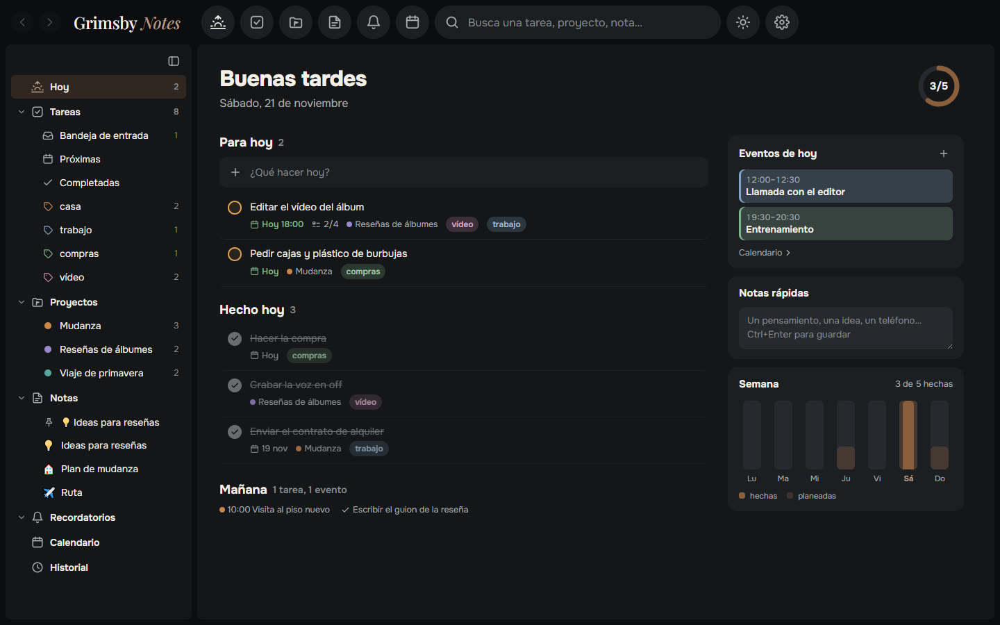
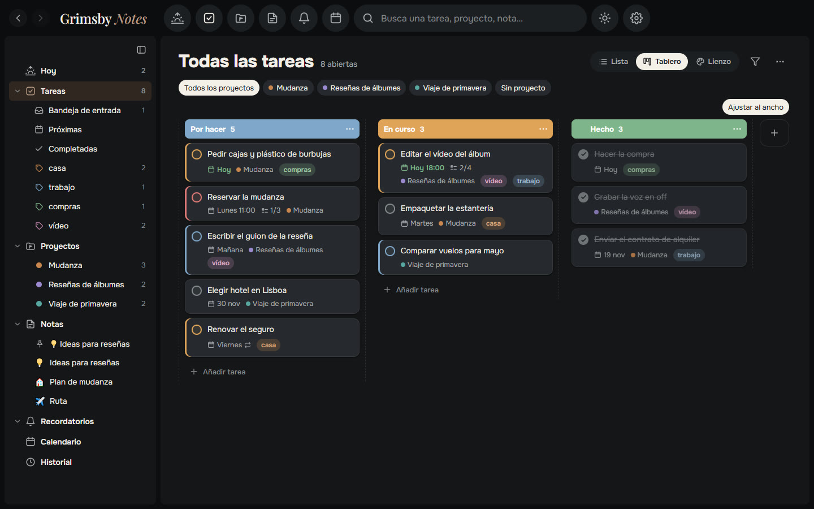
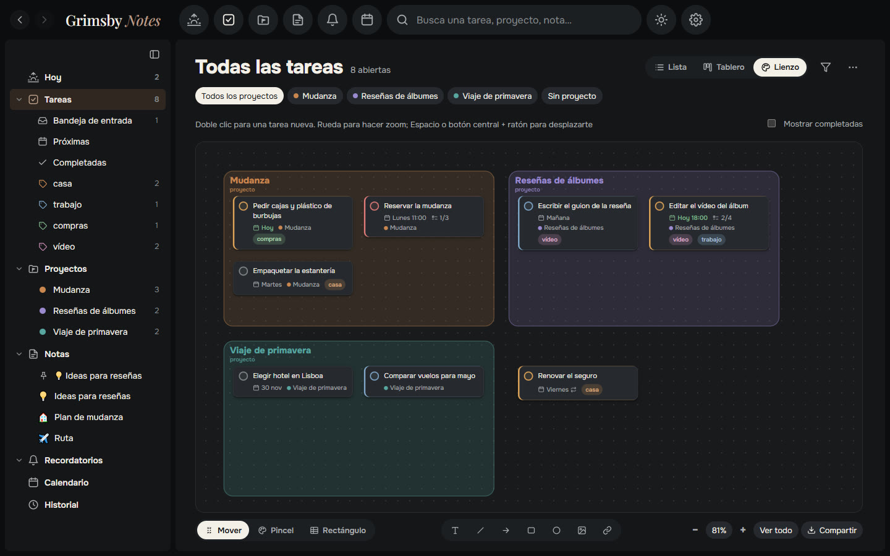
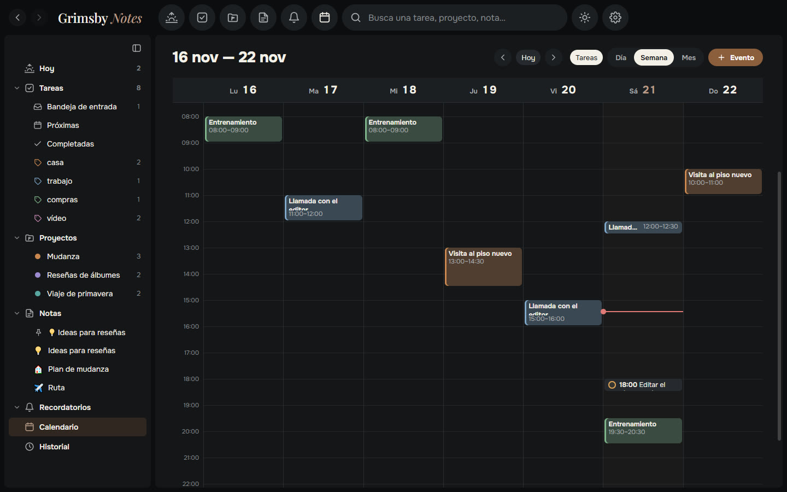
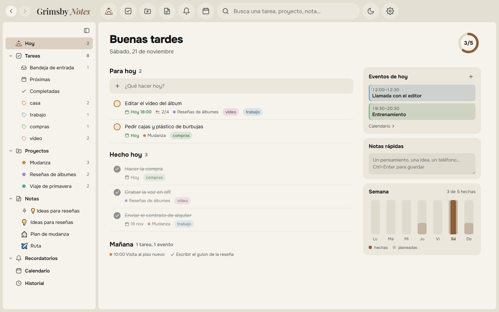

  <a href="README.md">English</a> ·
  <a href="README.ru.md">Русский</a> ·
  <b>Español</b> ·
  <a href="README.pt.md">Português</a> ·
  <a href="README.de.md">Deutsch</a> ·
  <a href="README.fr.md">Français</a> ·
  <a href="README.zh.md">中文</a> ·
  <a href="README.ja.md">日本語</a> ·
  <a href="README.ko.md">한국어</a>

  

  <b>Un planificador personal para Windows: tareas, proyectos, notas y calendario en una ventana.</b> 
  Todo se queda en tu ordenador: tareas en lista, tablero o un lienzo libre, proyectos con objetivos, notas enlazadas y recordatorios con notificaciones de Windows.

  
  
  
  
  

  <a href="https://github.com/maksimkhatskevich/grimsby-notes/releases/latest"><b>⬇ Descargar para Windows</b></a>
  &nbsp;·&nbsp;
  <a href="#funciones">Funciones</a>
  &nbsp;·&nbsp;
  <a href="#privacidad">Privacidad</a>
  &nbsp;·&nbsp;
  <a href="#contacto">Contacto</a>

---

## Por qué Grimsby Notes

Las tareas en una app, las notas en otra, el calendario en una tercera, y la mitad piden cuenta e internet. Un plan sencillo para el día acaba repartido entre servicios.

**Grimsby Notes lo mantiene todo junto y en casa.** Una ventana, un archivo de base de datos en tu ordenador, sin cuentas. Abre **Hoy** y verás lo urgente, lo planeado y lo ya hecho.

---

## Funciones

### ☀️ Hoy

Tareas atrasadas y planeadas, eventos del día, notas rápidas y un anillo de progreso de la semana. Añade una tarea ahí mismo en una línea: fechas como 25.12, hora, !prioridad, #etiquetas y @proyecto se reconocen al escribir.

### ✅ Tareas: lista y tablero

Bandeja de entrada, próximas y completadas, filtros y vistas guardadas. Un tablero con tus propias columnas y colores. Cada tarea tiene fecha y hora, prioridad, etiquetas, lista de comprobación, descripción, adjuntos con vista previa de fotos y vídeos, repeticiones y recordatorios. Una tarea puede estar en varios proyectos.

### 🎨 Lienzo

Un tablero libre donde las tareas se organizan por zonas de proyecto: mueve una tarjeta a una zona y se une al proyecto; ponla donde se cruzan dos zonas y pertenece a ambos. Zonas neutrales, texto, flechas, formas, imágenes y conectores entre tareas. Comparte todo el lienzo o la parte visible en PNG o PDF.

### 📁 Proyectos

Objetivo, estado, plazo y progreso. La pestaña **Acerca del proyecto** guarda para qué existe, el resultado esperado, los criterios de terminado con casillas, fechas clave y enlaces. Cada proyecto tiene su tablero y sus notas; los terminados pasan al archivo.

### 📝 Notas

Un editor por bloques con barra de formato: títulos, listas, casillas, tablas, imágenes, código y citas, fuentes, tamaños, colores y alineación. Páginas anidadas, [[enlaces]] a notas, tareas y proyectos, enlaces inversos, plantillas, secciones, archivo y papelera. Exportación a Markdown.

### 📅 Calendario y recordatorios

Día, semana y mes, eventos con repeticiones y colores, tareas con fecha en la misma cuadrícula. Recordatorios con listas, grupos y mosaicos. Notificaciones de Windows con **Hecho** y **Más tarde**, y un modo en segundo plano que avisa aunque la ventana esté cerrada.

🌍 **9 idiomas:** inglés, ruso, español, portugués, alemán, francés, chino, japonés y coreano; se cambian en Ajustes al instante.

El tema claro está a un clic: el botón del sol, arriba.

---

## Descargar e instalar

1. Abre la página de la **[última versión](https://github.com/maksimkhatskevich/grimsby-notes/releases/latest)** y descarga el instalador `.exe`.
2. Ejecútalo. Windows puede mostrar una ventana azul «Windows protegió su PC»: es un aviso normal para programas sin certificado de firma de pago. Pulsa **Más información → Ejecutar de todas formas**.
   El instalador se ha analizado en VirusTotal: [ninguno de 67 antivirus detecta nada](https://www.virustotal.com/gui/file/8cb8169d20871ca6ab8770230a99f93bde22d5c3a665340b5c1b44a92f20507f) (versión 1.0.0).
3. Abre **Hoy** y escribe tu primera tarea en la línea de arriba.

**Requisitos:** Windows 10 u 11 (64 bits). Internet solo hace falta para buscar actualizaciones.

---

## Privacidad

Grimsby Notes funciona en tu ordenador. Tareas, notas y adjuntos se guardan allí en un único archivo de base de datos, con una copia de seguridad diaria al lado. Sin cuentas, sin servidores de sincronización, sin anuncios, sin analíticas. La app solo se conecta para buscar actualizaciones (se puede desactivar); los enlaces de tus notas se abren en el navegador solo con Ctrl+clic.

---

## Las apps de Grimsby

<table>
  <tr>
    <td align="center" width="25%"><a href="https://github.com/maksimkhatskevich/grimsby-releases/blob/main/README.es.md"> <b>Grimsby Player</b></a> Reproductor sin conexión para tu música y videos descargados</td>
    <td align="center" width="25%"><a href="https://github.com/maksimkhatskevich/grimsby-converter/blob/main/README.es.md"> <b>Grimsby Converter</b></a> Video, audio, fotos y documentos, convertidos sin conexión</td>
    <td align="center" width="25%"><a href="https://github.com/maksimkhatskevich/grimsby-tagger/blob/main/README.es.md"> <b>Grimsby Tagger</b></a> Editor de etiquetas por lotes: álbumes, portadas, nombres de archivo</td>
    <td align="center" width="25%"><a href="https://github.com/maksimkhatskevich/grimsby-prompter/blob/main/README.es.md"> <b>Grimsby Prompter</b></a> Un teleprompter sencillo que sigue tu voz</td>
  </tr>
  <tr>
    <td align="center" width="25%"><a href="https://github.com/maksimkhatskevich/grimsby-helper/blob/main/README.es.md"> <b>Grimsby Helper</b></a> El estado de tu PC de un vistazo: procesos, temperaturas, limpieza</td>
    <td align="center" width="25%"><a href="https://github.com/maksimkhatskevich/grimsby-studio/blob/main/README.es.md"> <b>Grimsby Studio</b></a> Editor de video con insertos musicales animados</td>
    <td align="center" width="25%"> <b>Grimsby Notes</b> </td>
  </tr>
</table>

---

## Contacto

¿Encontraste un error, tienes una idea o solo quieres dar las gracias? Escríbeme:

- ✉️ correo: **[grimsbyy@gmail.com](mailto:grimsbyy@gmail.com)**
- 🐞 errores e ideas: [Issues](https://github.com/maksimkhatskevich/grimsby-notes/issues)
- 📣 Telegram: [@itsgrimsby](https://t.me/itsgrimsby) (en ruso)

---

## Licencias

Grimsby Notes usa componentes de código abierto, entre ellos Electron y React, y las fuentes Onest y Playfair Display. La lista completa con los textos de las licencias está en `THIRD_PARTY_NOTICES.txt`, en la carpeta del programa.

© 2026 Grimsby

