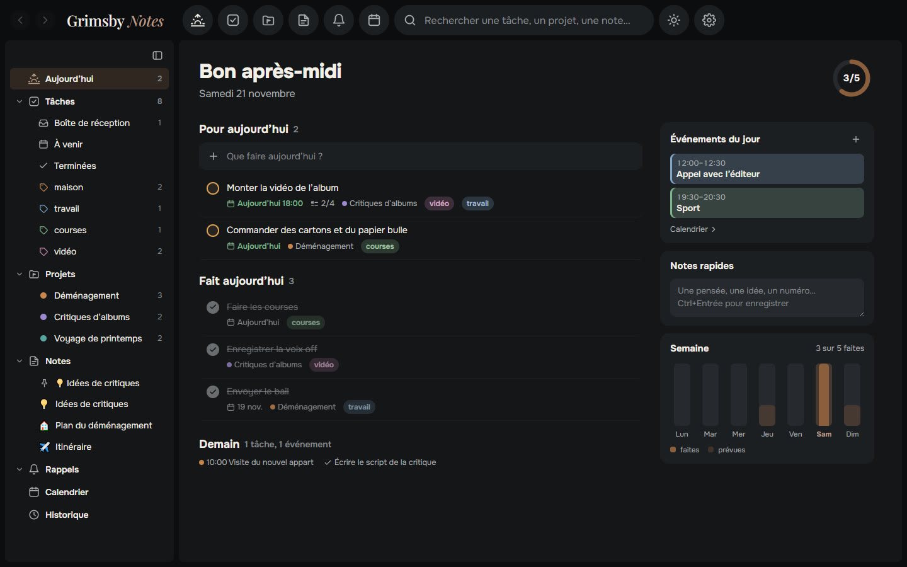
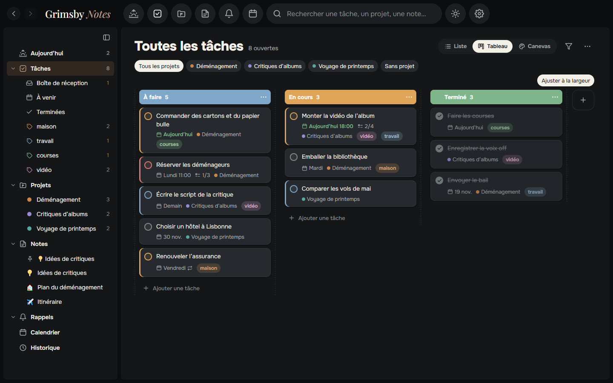
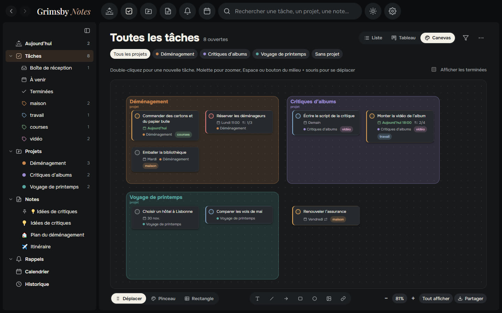
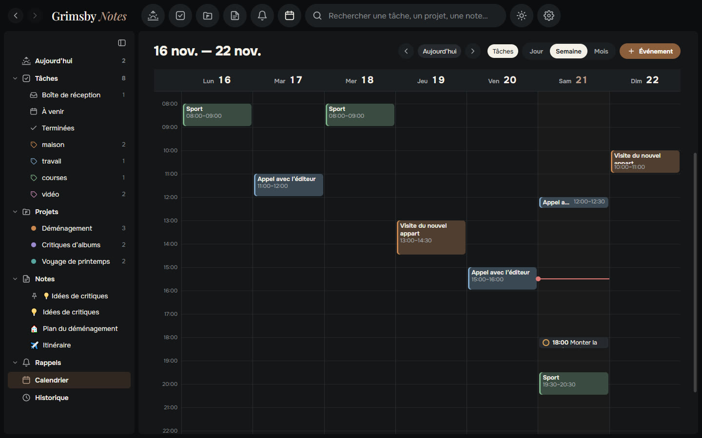
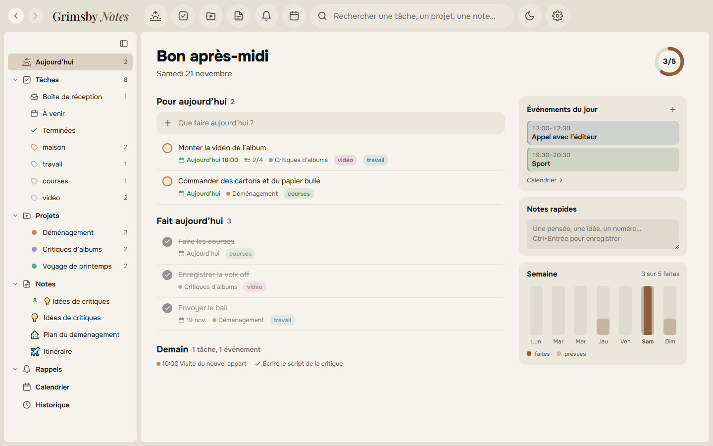

  <a href="README.md">English</a> ·
  <a href="README.ru.md">Русский</a> ·
  <a href="README.es.md">Español</a> ·
  <a href="README.pt.md">Português</a> ·
  <a href="README.de.md">Deutsch</a> ·
  <b>Français</b> ·
  <a href="README.zh.md">中文</a> ·
  <a href="README.ja.md">日本語</a> ·
  <a href="README.ko.md">한국어</a>

  

  <b>Un planificateur personnel pour Windows : tâches, projets, notes et calendrier dans une seule fenêtre.</b> 
  Tout reste sur votre ordinateur : tâches en liste, en tableau ou sur un canevas libre, projets avec objectifs, notes liées et rappels avec notifications Windows.

  
  
  
  
  

  <a href="https://github.com/maksimkhatskevich/grimsby-notes/releases/latest"><b>⬇ Télécharger pour Windows</b></a>
  &nbsp;·&nbsp;
  <a href="#fonctionnalités">Fonctionnalités</a>
  &nbsp;·&nbsp;
  <a href="#confidentialité">Confidentialité</a>
  &nbsp;·&nbsp;
  <a href="#contact">Contact</a>

---

## Pourquoi Grimsby Notes

Les tâches dans une application, les notes dans une autre, le calendrier dans une troisième — et la moitié exigent un compte et internet. Un simple plan de la journée finit éparpillé entre plusieurs services.

**Grimsby Notes garde tout ensemble, chez vous.** Une fenêtre, un fichier de base de données sur votre ordinateur, pas de compte. Ouvrez **Aujourd’hui** et voyez ce qui presse, ce qui est prévu et ce qui est déjà fait.

---

## Fonctionnalités

### ☀️ Aujourd’hui

Tâches en retard et prévues, événements du jour, notes rapides et un anneau de progression de la semaine. Ajoutez une tâche directement en une ligne : dates comme 25.12, heure, !priorité, #étiquettes et @projet sont reconnus pendant la saisie.

### ✅ Tâches : liste et tableau

Boîte de réception, à venir et terminées, filtres et vues enregistrées. Un tableau avec vos propres colonnes et couleurs. Chaque tâche a une échéance et une heure, une priorité, des étiquettes, une liste de contrôle, une description, des pièces jointes avec aperçu photo et vidéo, des répétitions et des rappels. Une tâche peut appartenir à plusieurs projets.

### 🎨 Canevas

Un espace libre où les tâches se rangent par zones de projet : glissez une carte dans une zone et elle rejoint le projet ; posez-la là où deux zones se croisent et elle appartient aux deux. Zones neutres, texte, flèches, formes, images et connecteurs entre tâches. Partagez tout le canevas ou la partie visible en PNG ou PDF.

### 📁 Projets

Objectif, statut, échéance et progression. L’onglet **À propos du projet** garde sa raison d’être, le résultat attendu, des critères de fin à cocher, les dates clés et des liens. Chaque projet a son tableau et ses notes ; les projets terminés passent aux archives.

### 📝 Notes

Un éditeur par blocs avec barre de mise en forme : titres, listes, cases à cocher, tableaux, images, code et citations, polices, tailles, couleurs et alignement. Pages imbriquées, [[liens]] vers notes, tâches et projets, rétroliens, modèles, sections, archives et corbeille. Export en Markdown.

### 📅 Calendrier et rappels

Jour, semaine et mois, événements avec répétitions et couleurs, tâches avec échéance dans la même grille. Rappels avec listes, groupes et tuiles. Notifications Windows avec **Fait** et **Plus tard**, et un mode en arrière-plan qui vous rappelle même fenêtre fermée.

🌍 **9 langues :** anglais, russe, espagnol, portugais, allemand, français, chinois, japonais et coréen — à changer dans les Réglages, effet immédiat.

Le thème clair est à un clic — le bouton soleil en haut.

---

## Télécharger et installer

1. Ouvrez la page de la **[dernière version](https://github.com/maksimkhatskevich/grimsby-notes/releases/latest)** et téléchargez l’installeur `.exe`.
2. Lancez-le. Windows peut afficher une fenêtre bleue « Windows a protégé votre ordinateur » : c’est un avertissement normal pour les logiciels sans certificat de signature payant. Cliquez sur **Informations complémentaires → Exécuter quand même**.
   L’installeur a été vérifié sur VirusTotal : [aucun des 67 antivirus ne détecte quoi que ce soit](https://www.virustotal.com/gui/file/8cb8169d20871ca6ab8770230a99f93bde22d5c3a665340b5c1b44a92f20507f) (version 1.0.0).
3. Ouvrez **Aujourd’hui** et tapez votre première tâche dans la ligne du haut.

**Configuration requise :** Windows 10 ou 11 (64 bits). Internet n’est nécessaire que pour vérifier les mises à jour.

---

## Confidentialité

Grimsby Notes fonctionne sur votre ordinateur. Tâches, notes et pièces jointes y sont conservées dans un seul fichier de base de données, avec une sauvegarde quotidienne à côté. Pas de compte, pas de serveur de synchronisation, pas de publicité, pas de statistiques. L’application ne se connecte que pour vérifier les mises à jour (désactivable) ; les liens de vos notes s’ouvrent dans le navigateur seulement avec Ctrl+clic.

---

## Les applis Grimsby

<table>
  <tr>
    <td align="center" width="25%"><a href="https://github.com/maksimkhatskevich/grimsby-releases/blob/main/README.fr.md"> <b>Grimsby Player</b></a> Lecteur hors ligne pour votre musique et vos clips téléchargés</td>
    <td align="center" width="25%"><a href="https://github.com/maksimkhatskevich/grimsby-converter/blob/main/README.fr.md"> <b>Grimsby Converter</b></a> Vidéo, audio, photos et documents convertis hors ligne</td>
    <td align="center" width="25%"><a href="https://github.com/maksimkhatskevich/grimsby-tagger/blob/main/README.fr.md"> <b>Grimsby Tagger</b></a> Éditeur de tags par lots : albums, pochettes, noms de fichiers</td>
    <td align="center" width="25%"><a href="https://github.com/maksimkhatskevich/grimsby-prompter/blob/main/README.fr.md"> <b>Grimsby Prompter</b></a> Un téléprompteur simple qui suit votre voix</td>
  </tr>
  <tr>
    <td align="center" width="25%"><a href="https://github.com/maksimkhatskevich/grimsby-helper/blob/main/README.fr.md"> <b>Grimsby Helper</b></a> L’état de votre PC en un coup d’œil : processus, températures, nettoyage</td>
    <td align="center" width="25%"><a href="https://github.com/maksimkhatskevich/grimsby-studio/blob/main/README.fr.md"> <b>Grimsby Studio</b></a> Éditeur vidéo avec des habillages musicaux animés</td>
    <td align="center" width="25%"> <b>Grimsby Notes</b> </td>
  </tr>
</table>

---

## Contact

Un bug, une idée ou juste envie de dire merci ? Écrivez-moi :

- ✉️ e-mail: **[grimsbyy@gmail.com](mailto:grimsbyy@gmail.com)**
- 🐞 bugs et idées: [Issues](https://github.com/maksimkhatskevich/grimsby-notes/issues)
- 📣 Telegram : [@itsgrimsby](https://t.me/itsgrimsby) (en russe)

---

## Licences

Grimsby Notes utilise des composants open source, dont Electron et React, ainsi que les polices Onest et Playfair Display. La liste complète avec les textes des licences se trouve dans `THIRD_PARTY_NOTICES.txt`, dans le dossier du programme.

© 2026 Grimsby

