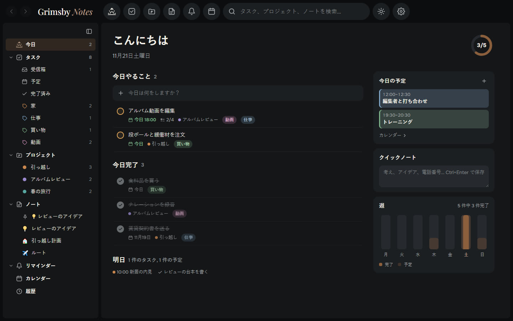
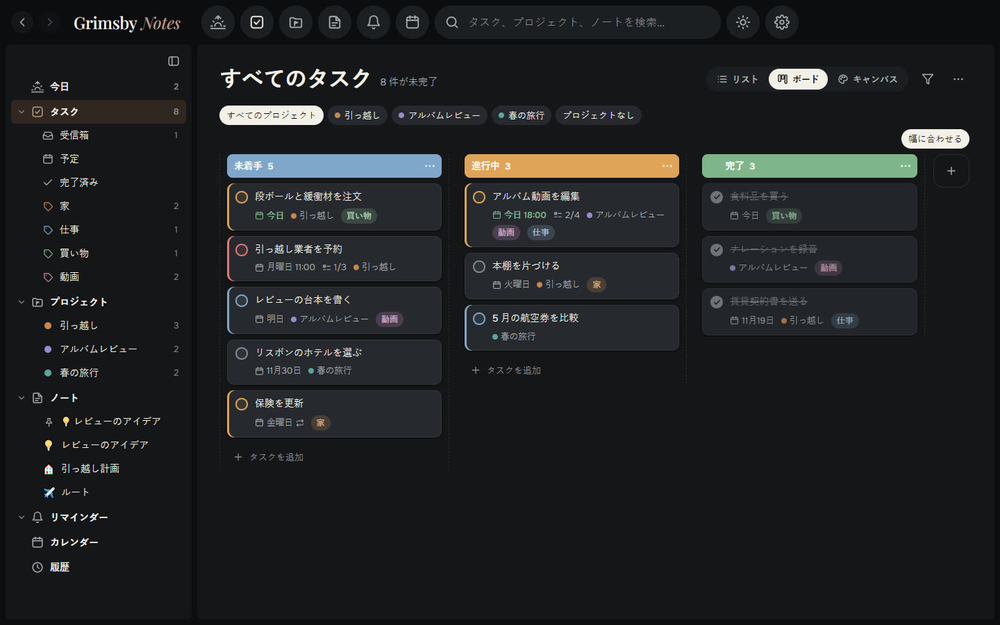
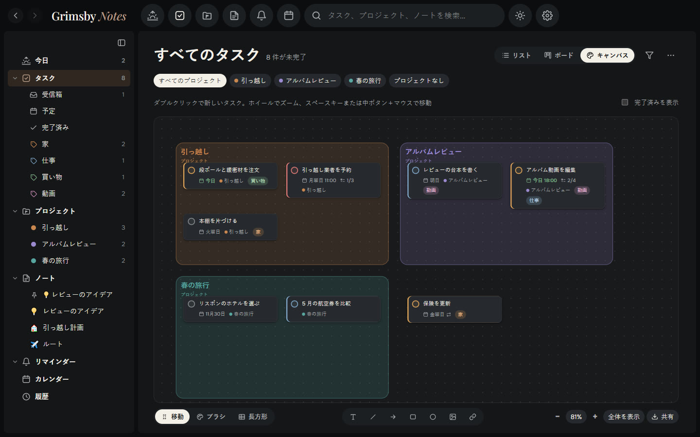
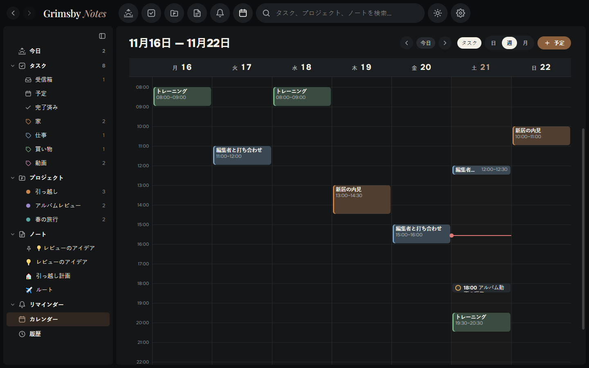
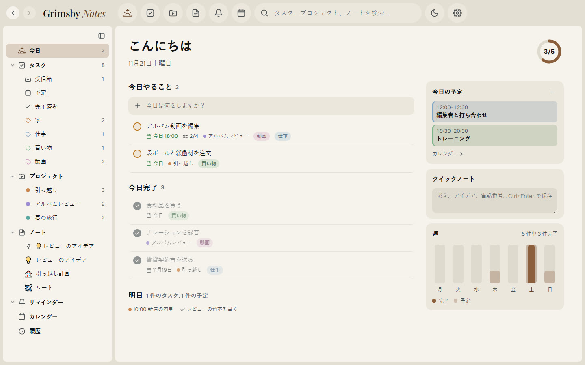

  <a href="README.md">English</a> ·
  <a href="README.ru.md">Русский</a> ·
  <a href="README.es.md">Español</a> ·
  <a href="README.pt.md">Português</a> ·
  <a href="README.de.md">Deutsch</a> ·
  <a href="README.fr.md">Français</a> ·
  <a href="README.zh.md">中文</a> ·
  <b>日本語</b> ·
  <a href="README.ko.md">한국어</a>

  

  <b>Windows 用の個人プランナー。タスク、プロジェクト、ノート、カレンダーをひとつのウィンドウで。</b> 
  すべてパソコンの中に保存。タスクはリスト、ボード、自由なキャンバスで。目標つきのプロジェクト、リンクし合うノート、Windows 通知で届くリマインダー。

  
  
  
  
  

  <a href="https://github.com/maksimkhatskevich/grimsby-notes/releases/latest"><b>⬇ Windows 版をダウンロード</b></a>
  &nbsp;·&nbsp;
  <a href="#機能">機能</a>
  &nbsp;·&nbsp;
  <a href="#プライバシー">プライバシー</a>
  &nbsp;·&nbsp;
  <a href="#お問い合わせ">お問い合わせ</a>

---

## Grimsby Notes を選ぶ理由

タスクはこのアプリ、ノートはあのアプリ、カレンダーはまた別のアプリ。しかも半分はアカウントとネット接続が必要です。1 日のシンプルな予定がいくつものサービスに散らばります。

**Grimsby Notes はすべてをまとめて、手元に置きます。** ウィンドウはひとつ、データベースファイルもパソコンにひとつ、アカウントは不要。**今日** を開けば、期限のもの、予定のもの、済んだものがひと目でわかります。

---

## 機能

### ☀️ 今日

期限切れと予定のタスク、今日の予定、クイックメモ、週の進捗リング。その場で 1 行でタスクを追加：25.12 のような日付、時刻、!優先度、#タグ、@プロジェクトを入力中に認識します。

### ✅ タスク：リストとボード

受信箱、今後の予定、完了済み、フィルターと保存したビュー。列と色を自由に決められるボード。タスクごとに期限と時刻、優先度、タグ、チェックリスト、説明、写真と動画をプレビューできる添付ファイル、繰り返し、リマインダー。ひとつのタスクを複数のプロジェクトに入れられます。

### 🎨 キャンバス

タスクをプロジェクトのエリアごとに並べる自由なボード。カードをエリアに入れるとそのプロジェクトに、2 つのエリアが重なる場所に置けば両方に属します。ニュートラルゾーン、テキスト、矢印、図形、画像、タスク同士をつなぐコネクター。キャンバス全体または表示部分を PNG や PDF で共有。

### 📁 プロジェクト

目標、状態、期限、進捗。**プロジェクトについて** タブには、目的、期待する成果、チェックできる完了条件、重要な日付、リンクをまとめられます。プロジェクトごとに専用のボードとノート。完了したものはアーカイブへ。

### 📝 ノート

書式ツールバーつきのブロックエディター：見出し、リスト、チェックリスト、表、画像、コード、引用、フォント、サイズ、色、配置。入れ子のページ、ノート・タスク・プロジェクトへの [[リンク]]、バックリンク、テンプレート、セクション、アーカイブ、ゴミ箱。Markdown に書き出し。

### 📅 カレンダーとリマインダー

日・週・月表示、繰り返しと色つきの予定、期限のあるタスクも同じグリッドに。リマインダーはリスト、グループ、タイルで整理。**完了** と **あとで** ボタンつきの Windows 通知と、ウィンドウを閉じていても知らせるバックグラウンドモード。

🌍 **9 言語：** 英語、ロシア語、スペイン語、ポルトガル語、ドイツ語、フランス語、中国語、日本語、韓国語。設定で切り替えるとすぐに反映されます。

ライトテーマもワンクリック。上の太陽ボタンです。

---

## ダウンロードとインストール

1. **[最新バージョン](https://github.com/maksimkhatskevich/grimsby-notes/releases/latest)** のページを開き、インストーラー `.exe` をダウンロードします。
2. 実行します。Windows に青い「Windows によって PC が保護されました」画面が出ることがありますが、有料の署名証明書がないアプリでは普通の警告です。**詳細情報 → 実行** をクリックしてください。
   インストーラーは VirusTotal で確認済みです：[67 のウイルス対策エンジンすべてで検出なし](https://www.virustotal.com/gui/file/8cb8169d20871ca6ab8770230a99f93bde22d5c3a665340b5c1b44a92f20507f)（バージョン 1.0.0）。
3. **今日** を開き、上の入力行に最初のタスクを書き込みます。

**動作環境：** Windows 10 / 11（64 ビット）。

---

## プライバシー

Grimsby Notes はパソコンの中で動作します。タスク、ノート、添付ファイルはそこにあるひとつのデータベースファイルに保存され、その横に毎日のバックアップが作られます。アカウントなし、同期サーバーなし、広告なし、解析なし。インターネットに接続するのはアップデートの確認だけ（オフ可）。ノート内のリンクは Ctrl+クリックしたときだけブラウザーで開きます。

---

## Grimsby のアプリ

<table>
  <tr>
    <td align="center" width="25%"><a href="https://github.com/maksimkhatskevich/grimsby-releases/blob/main/README.ja.md"> <b>Grimsby Player</b></a> ダウンロードした音楽と MV のためのオフラインプレーヤー</td>
    <td align="center" width="25%"><a href="https://github.com/maksimkhatskevich/grimsby-converter/blob/main/README.ja.md"> <b>Grimsby Converter</b></a> 動画・音声・写真・文書をオフラインで変換</td>
    <td align="center" width="25%"><a href="https://github.com/maksimkhatskevich/grimsby-tagger/blob/main/README.ja.md"> <b>Grimsby Tagger</b></a> タグ一括編集：アルバム、カバー、ファイル名</td>
    <td align="center" width="25%"><a href="https://github.com/maksimkhatskevich/grimsby-prompter/blob/main/README.ja.md"> <b>Grimsby Prompter</b></a> 声についてくる、シンプルなプロンプター</td>
  </tr>
  <tr>
    <td align="center" width="25%"><a href="https://github.com/maksimkhatskevich/grimsby-helper/blob/main/README.ja.md"> <b>Grimsby Helper</b></a> PC の状態がひと目でわかる：プロセス、温度、クリーンアップ</td>
    <td align="center" width="25%"><a href="https://github.com/maksimkhatskevich/grimsby-studio/blob/main/README.ja.md"> <b>Grimsby Studio</b></a> アニメーション付き音楽インサートが作れる動画エディター</td>
    <td align="center" width="25%"> <b>Grimsby Notes</b> </td>
  </tr>
</table>

---

## お問い合わせ

不具合を見つけた、アイデアがある、またはお礼を伝えたい？ご連絡ください：

- ✉️ メール: **[grimsbyy@gmail.com](mailto:grimsbyy@gmail.com)**
- 🐞 不具合とアイデア: [Issues](https://github.com/maksimkhatskevich/grimsby-notes/issues)
- 📣 Telegram：[@itsgrimsby](https://t.me/itsgrimsby)（ロシア語）

---

## ライセンス

Grimsby Notes は Electron、React などのオープンソースコンポーネントと、Onest、Playfair Display フォントを使用しています。ライセンス本文つきの完全な一覧はプログラムフォルダーの `THIRD_PARTY_NOTICES.txt` にあります。

© 2026 Grimsby

