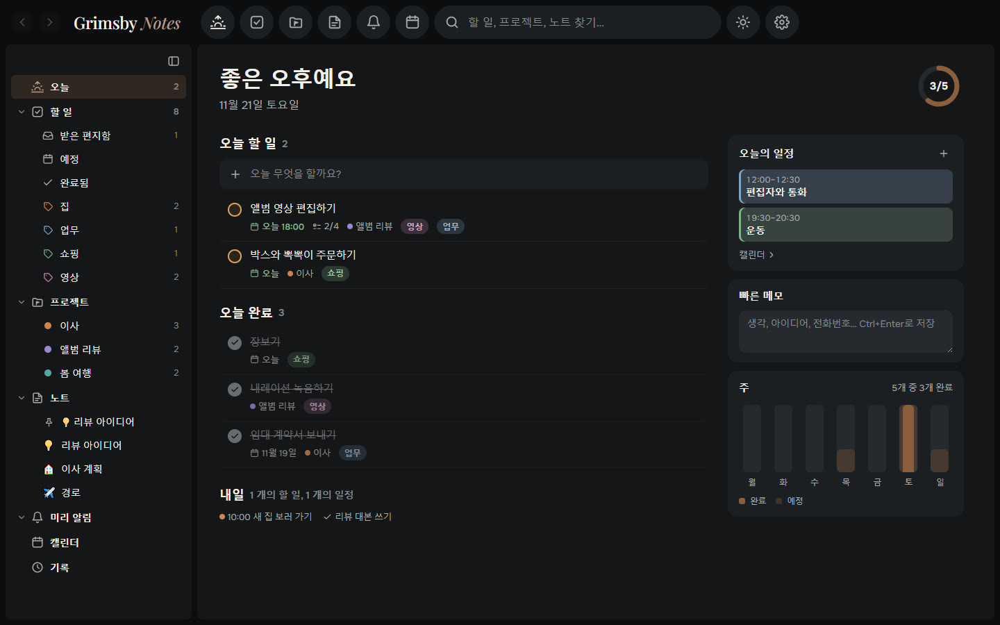
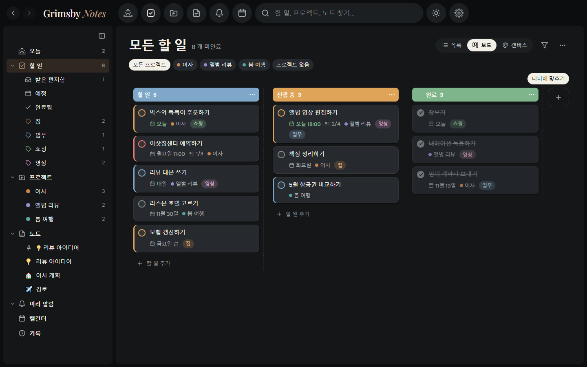
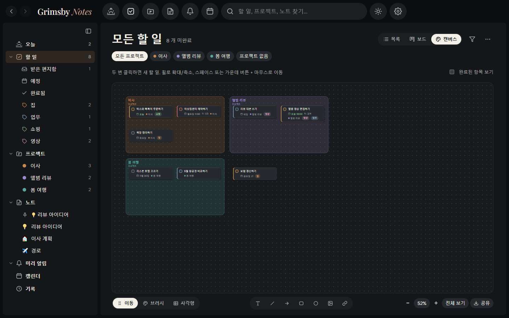
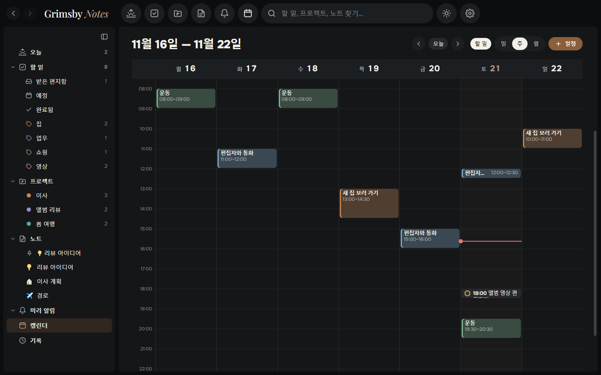
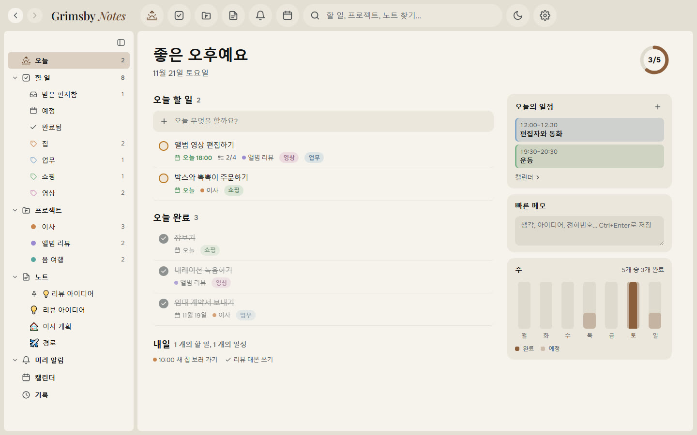

  <a href="README.md">English</a> ·
  <a href="README.ru.md">Русский</a> ·
  <a href="README.es.md">Español</a> ·
  <a href="README.pt.md">Português</a> ·
  <a href="README.de.md">Deutsch</a> ·
  <a href="README.fr.md">Français</a> ·
  <a href="README.zh.md">中文</a> ·
  <a href="README.ja.md">日本語</a> ·
  <b>한국어</b>

  

  <b>Windows용 개인 플래너: 할 일, 프로젝트, 노트, 캘린더를 한 창에서.</b> 
  모든 것이 내 컴퓨터에 남습니다. 할 일은 목록, 보드, 자유 캔버스로, 목표가 있는 프로젝트, 서로 연결된 노트, Windows 알림으로 오는 미리 알림.

  
  
  
  
  

  <a href="https://github.com/maksimkhatskevich/grimsby-notes/releases/latest"><b>⬇ Windows용 다운로드</b></a>
  &nbsp;·&nbsp;
  <a href="#기능">기능</a>
  &nbsp;·&nbsp;
  <a href="#개인정보">개인정보</a>
  &nbsp;·&nbsp;
  <a href="#문의">문의</a>

---

## 왜 Grimsby Notes인가

할 일은 이 앱, 노트는 저 앱, 캘린더는 또 다른 앱에 — 게다가 절반은 계정과 인터넷이 필요합니다. 하루의 간단한 계획이 여러 서비스에 흩어지죠.

**Grimsby Notes는 모든 것을 한곳에, 내 컴퓨터에 둡니다.** 창 하나, 컴퓨터에 데이터베이스 파일 하나, 계정은 필요 없습니다. **오늘**을 열면 급한 일, 계획한 일, 끝낸 일이 한눈에 보입니다.

---

## 기능

### ☀️ 오늘

기한이 지난 할 일과 계획한 할 일, 오늘의 일정, 빠른 메모, 이번 주 진행률 링. 그 자리에서 한 줄로 할 일을 추가하세요. 25.12 같은 날짜, 시간, !우선순위, #태그, @프로젝트를 입력하는 동안 알아봅니다.

### ✅ 할 일: 목록과 보드

받은 편지함, 예정, 완료, 필터와 저장한 보기. 열과 색을 마음대로 정하는 보드. 할 일마다 마감일과 시간, 우선순위, 태그, 체크리스트, 설명, 사진·동영상 미리 보기가 되는 첨부 파일, 반복, 미리 알림. 하나의 할 일이 여러 프로젝트에 속할 수 있습니다.

### 🎨 캔버스

할 일을 프로젝트 영역별로 배치하는 자유로운 보드. 카드를 영역에 넣으면 그 프로젝트에, 두 영역이 겹치는 곳에 두면 두 프로젝트 모두에 속합니다. 중립 구역, 텍스트, 화살표, 도형, 이미지, 할 일 사이의 연결선. 캔버스 전체나 보이는 부분을 PNG 또는 PDF로 공유하세요.

### 📁 프로젝트

목표, 상태, 마감일, 진행률. **프로젝트 정보** 탭에는 프로젝트의 이유, 기대 결과, 체크할 수 있는 완료 기준, 주요 날짜와 링크를 담습니다. 프로젝트마다 고유한 보드와 노트가 있고, 끝난 프로젝트는 보관함으로 갑니다.

### 📝 노트

서식 도구 모음이 있는 블록 편집기: 제목, 목록, 체크리스트, 표, 이미지, 코드, 인용, 글꼴, 크기, 색, 정렬. 중첩 페이지, 노트·할 일·프로젝트로 가는 [[링크]], 백링크, 템플릿, 섹션, 보관함과 휴지통. Markdown으로 내보내기.

### 📅 캘린더와 미리 알림

일·주·월 보기, 반복과 색이 있는 일정, 마감일이 있는 할 일도 같은 그리드에. 목록, 그룹, 타일로 정리하는 미리 알림. **완료**와 **나중에** 버튼이 있는 Windows 알림, 창을 닫아도 알려 주는 백그라운드 모드.

🌍 **9개 언어:** 영어, 러시아어, 스페인어, 포르투갈어, 독일어, 프랑스어, 중국어, 일본어, 한국어 — 설정에서 바꾸면 바로 적용됩니다.

라이트 테마도 클릭 한 번, 위쪽의 해 모양 버튼입니다.

---

## 다운로드 및 설치

1. **[최신 버전](https://github.com/maksimkhatskevich/grimsby-notes/releases/latest)** 페이지를 열고 설치 프로그램 `.exe`를 다운로드하세요.
2. 실행하세요. Windows가 파란색 "Windows의 PC 보호" 창을 띄울 수 있는데, 유료 코드 서명 인증서가 없는 프로그램에 대한 일반적인 경고입니다. **추가 정보 → 실행**을 누르세요.
   설치 프로그램은 VirusTotal에서 검사했습니다: [백신 엔진 67개 모두 이상 없음](https://www.virustotal.com/gui/file/8cb8169d20871ca6ab8770230a99f93bde22d5c3a665340b5c1b44a92f20507f) (버전 1.0.0).
3. **오늘**을 열고 위쪽 입력 줄에 첫 할 일을 적으세요.

**요구 사항:** Windows 10 또는 11(64비트). 인터넷은 업데이트 확인에만 필요합니다.

---

## 개인정보

Grimsby Notes는 내 컴퓨터에서 동작합니다. 할 일, 노트, 첨부 파일은 그곳의 데이터베이스 파일 하나에 저장되고, 옆에 매일 백업이 만들어집니다. 계정, 동기화 서버, 광고, 분석 없음. 인터넷에는 업데이트 확인(끌 수 있음)할 때만 연결하며, 노트 속 링크는 Ctrl+클릭할 때만 브라우저에서 열립니다.

---

## Grimsby 앱

<table>
  <tr>
    <td align="center" width="25%"><a href="https://github.com/maksimkhatskevich/grimsby-releases/blob/main/README.ko.md"> <b>Grimsby Player</b></a> 다운로드한 음악과 뮤직비디오를 위한 오프라인 플레이어</td>
    <td align="center" width="25%"><a href="https://github.com/maksimkhatskevich/grimsby-converter/blob/main/README.ko.md"> <b>Grimsby Converter</b></a> 영상, 오디오, 사진, 문서를 오프라인으로 변환</td>
    <td align="center" width="25%"><a href="https://github.com/maksimkhatskevich/grimsby-tagger/blob/main/README.ko.md"> <b>Grimsby Tagger</b></a> 태그 일괄 편집: 앨범, 커버, 파일 이름</td>
    <td align="center" width="25%"><a href="https://github.com/maksimkhatskevich/grimsby-prompter/blob/main/README.ko.md"> <b>Grimsby Prompter</b></a> 목소리를 따라가는 간단한 프롬프터</td>
  </tr>
  <tr>
    <td align="center" width="25%"><a href="https://github.com/maksimkhatskevich/grimsby-helper/blob/main/README.ko.md"> <b>Grimsby Helper</b></a> PC 상태를 한눈에: 프로세스, 온도, 정리</td>
    <td align="center" width="25%"><a href="https://github.com/maksimkhatskevich/grimsby-studio/blob/main/README.ko.md"> <b>Grimsby Studio</b></a> 애니메이션 음악 인서트를 만드는 동영상 편집기</td>
    <td align="center" width="25%"> <b>Grimsby Notes</b> </td>
  </tr>
</table>

---

## 문의

버그를 찾았거나, 아이디어가 있거나, 그냥 고맙다고 말하고 싶다면 연락 주세요:

- ✉️ 이메일: **[grimsbyy@gmail.com](mailto:grimsbyy@gmail.com)**
- 🐞 버그와 아이디어: [Issues](https://github.com/maksimkhatskevich/grimsby-notes/issues)
- 📣 Telegram: [@itsgrimsby](https://t.me/itsgrimsby) (러시아어)

---

## 라이선스

Grimsby Notes는 Electron, React 등 오픈 소스 구성 요소와 Onest, Playfair Display 글꼴을 사용합니다. 라이선스 전문이 포함된 전체 목록은 프로그램 폴더의 `THIRD_PARTY_NOTICES.txt`에 있습니다.

© 2026 Grimsby

