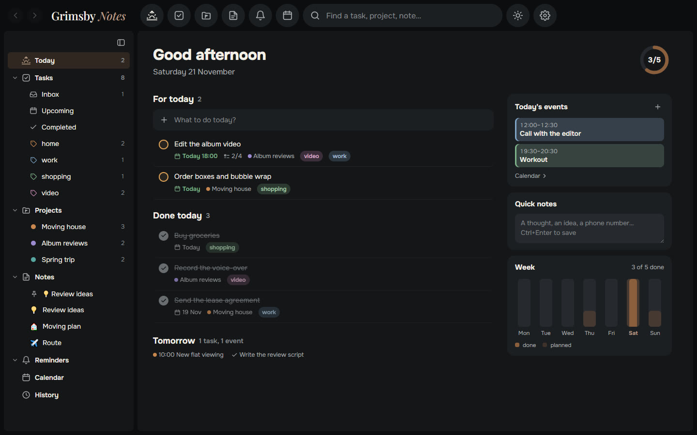
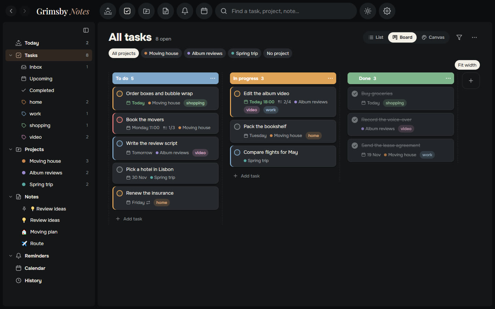
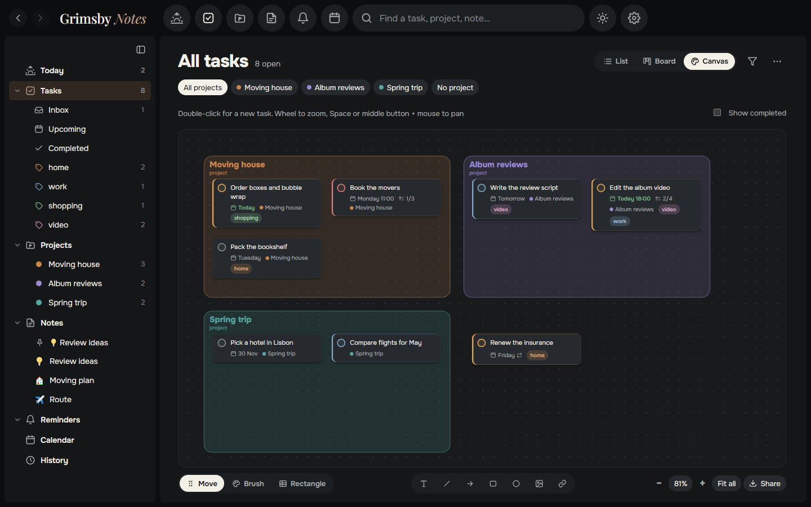
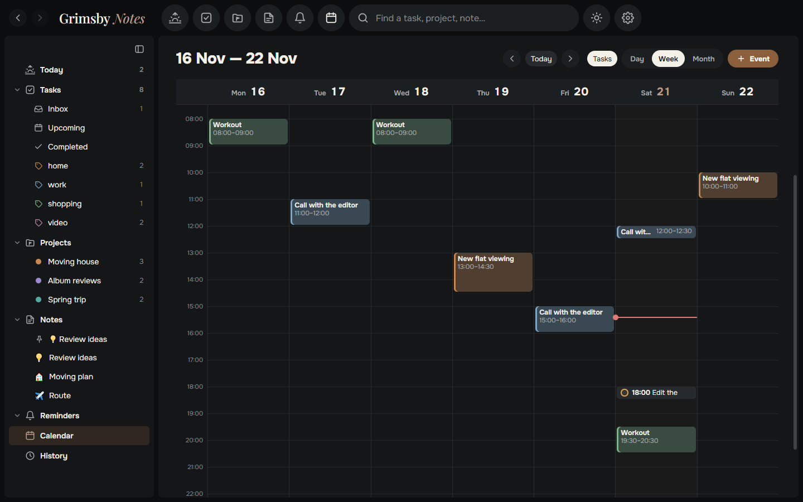
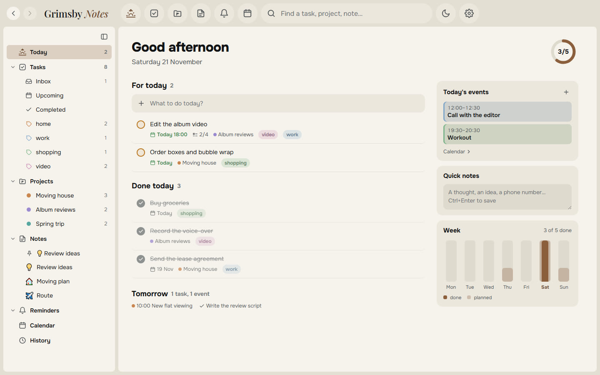

  <b>English</b> ·
  <a href="README.ru.md">Русский</a> ·
  <a href="README.es.md">Español</a> ·
  <a href="README.pt.md">Português</a> ·
  <a href="README.de.md">Deutsch</a> ·
  <a href="README.fr.md">Français</a> ·
  <a href="README.zh.md">中文</a> ·
  <a href="README.ja.md">日本語</a> ·
  <a href="README.ko.md">한국어</a>

  

  <b>A personal planner for Windows: tasks, projects, notes and a calendar in one window.</b> 
  Everything stays on your computer: tasks as a list, a board or a free canvas, projects with goals, linked notes, reminders with Windows notifications.

  
  
  
  
  

  <a href="https://github.com/maksimkhatskevich/grimsby-notes/releases/latest"><b>⬇ Download for Windows</b></a>
  &nbsp;·&nbsp;
  <a href="#features">Features</a>
  &nbsp;·&nbsp;
  <a href="#privacy">Privacy</a>
  &nbsp;·&nbsp;
  <a href="#feedback">Feedback</a>

---

## Why Grimsby Notes

Tasks live in one app, notes in another, the calendar in a third — and half of them want an account and an internet connection. A simple plan for the day ends up scattered across services.

**Grimsby Notes keeps it together and at home.** One window, one database file on your computer, no accounts. Open **Today** and see what is due, what is planned and what is already done.

---

## Features

### ☀️ Today

Overdue and planned tasks, today’s events, quick notes and a progress ring for the week. Add a task right there in one line: dates like 25.12, time, !priority, #tags and @project are recognized as you type.

### ✅ Tasks: list and board

Inbox, upcoming and completed, filters and saved views. A board with your own columns and colors. Each task has a due date and time, priority, tags, a checklist, a description, attachments with photo and video preview, repeats and reminders. A task can belong to several projects.

### 🎨 Canvas

A free board where tasks are laid out by project areas: move a card into an area and it joins the project; put it where two areas overlap and it belongs to both. Neutral zones, text, arrows, shapes, images and connectors between tasks. Share the whole canvas or the visible part as PNG or PDF.

### 📁 Projects

Goal, status, deadline and progress. The **About** tab keeps why the project exists, the expected result, done criteria with checkboxes, key dates and links. Each project has its own board and notes; finished projects go to the archive.

### 📝 Notes

A block editor with a formatting toolbar: headings, lists, checklists, tables, images, code and quotes, fonts, sizes, colors and alignment. Nested pages, [[links]] to notes, tasks and projects, backlinks, templates, sections, archive and trash. Export to Markdown.

### 📅 Calendar and reminders

Day, week and month, events with repeats and colors, tasks with a due date right in the grid. Reminders with lists, groups and tiles. Windows notifications with **Done** and **Later**, and an optional background mode that reminds you even when the window is closed.

🌍 **9 languages:** English, Russian, Spanish, Portuguese, German, French, Chinese, Japanese and Korean — switch in Settings, it changes right away.

The light theme is one click away — the sun button at the top.

---

## Download and install

1. Open the **[latest release](https://github.com/maksimkhatskevich/grimsby-notes/releases/latest)** page and download the installer `.exe`.
2. Run it. Windows may show a blue "Windows protected your PC" window — that's a normal warning for apps without a paid code-signing certificate. Click **More info → Run anyway**.
   The installer has been checked on VirusTotal: [0 of 67 antivirus engines flag it](https://www.virustotal.com/gui/file/8cb8169d20871ca6ab8770230a99f93bde22d5c3a665340b5c1b44a92f20507f) (version 1.0.0).
3. Open **Today** and type your first task in the line at the top.

**Requirements:** Windows 10 or 11 (64-bit). Internet is needed only to check for updates.

---

## Privacy

Grimsby Notes works on your computer. Tasks, notes and attachments are kept in one database file there, with a daily backup next to it. No accounts, no sync servers, no ads, no analytics. The app goes online only to check for updates (this can be turned off); links from your notes open in your browser only on Ctrl+click.

---

## Grimsby apps

<table>
  <tr>
    <td align="center" width="25%"><a href="https://github.com/maksimkhatskevich/grimsby-releases"> <b>Grimsby Player</b></a> Offline music & video player for your downloaded collection</td>
    <td align="center" width="25%"><a href="https://github.com/maksimkhatskevich/grimsby-converter"> <b>Grimsby Converter</b></a> Video, audio, photos and documents — converted offline</td>
    <td align="center" width="25%"><a href="https://github.com/maksimkhatskevich/grimsby-tagger"> <b>Grimsby Tagger</b></a> Batch tag editor: albums, covers, file names</td>
    <td align="center" width="25%"><a href="https://github.com/maksimkhatskevich/grimsby-prompter"> <b>Grimsby Prompter</b></a> A simple teleprompter that follows your voice</td>
  </tr>
  <tr>
    <td align="center" width="25%"><a href="https://github.com/maksimkhatskevich/grimsby-helper"> <b>Grimsby Helper</b></a> PC health at a glance: processes, temperatures, cleanup</td>
    <td align="center" width="25%"><a href="https://github.com/maksimkhatskevich/grimsby-studio"> <b>Grimsby Studio</b></a> Video editor with animated music inserts</td>
    <td align="center" width="25%"> <b>Grimsby Notes</b> </td>
  </tr>
</table>

---

## Feedback

Found a bug, have an idea or just want to say thanks? Get in touch:

- ✉️ email: **[grimsbyy@gmail.com](mailto:grimsbyy@gmail.com)**
- 🐞 bugs and ideas: [Issues](https://github.com/maksimkhatskevich/grimsby-notes/issues)
- 📣 Telegram: [@itsgrimsby](https://t.me/itsgrimsby) (in Russian)

---

## Licenses

Grimsby Notes uses open-source components, including Electron and React, and the Onest and Playfair Display fonts. The full list with license texts is in `THIRD_PARTY_NOTICES.txt` in the program folder.

© 2026 Grimsby

