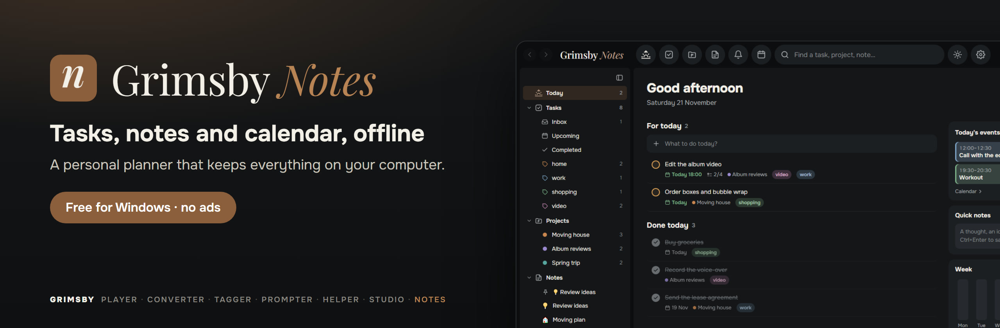
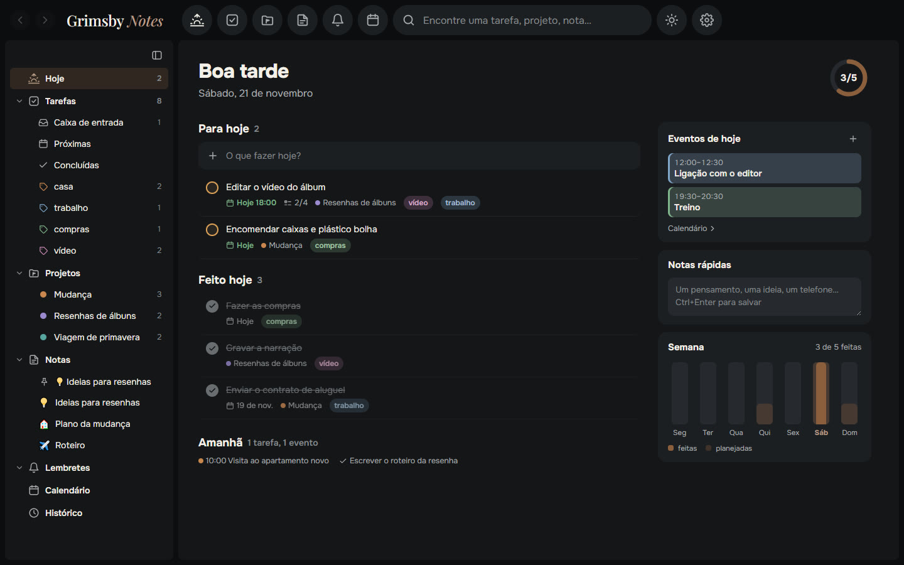
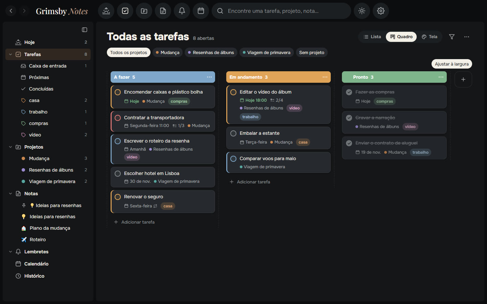
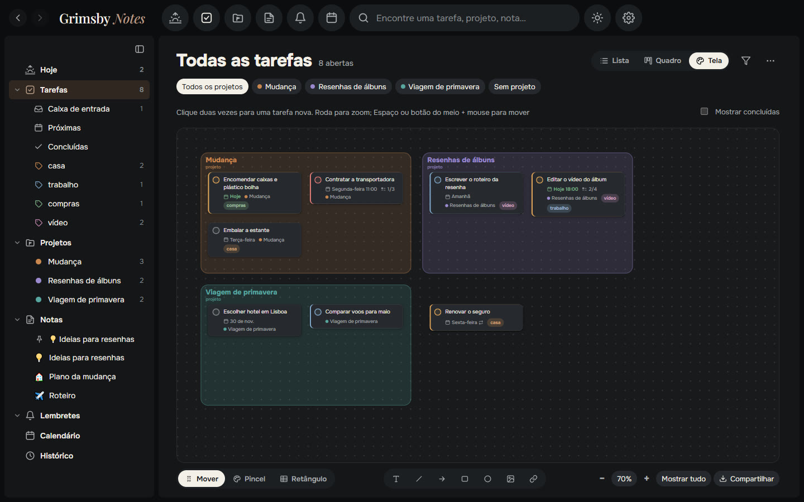
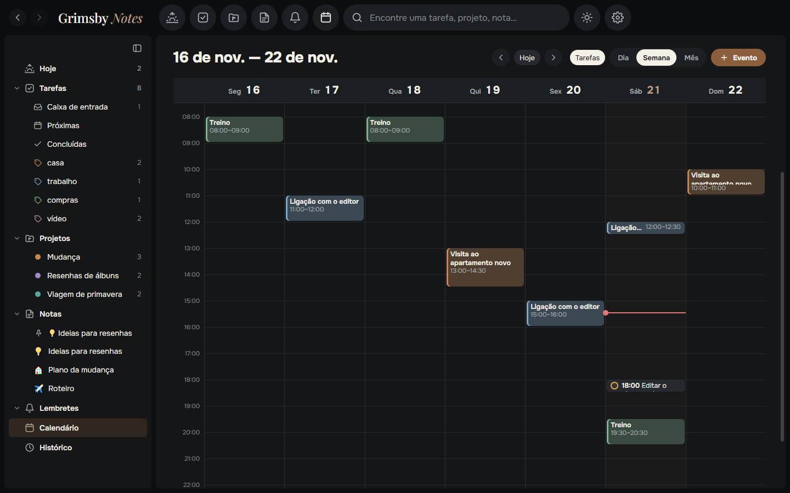
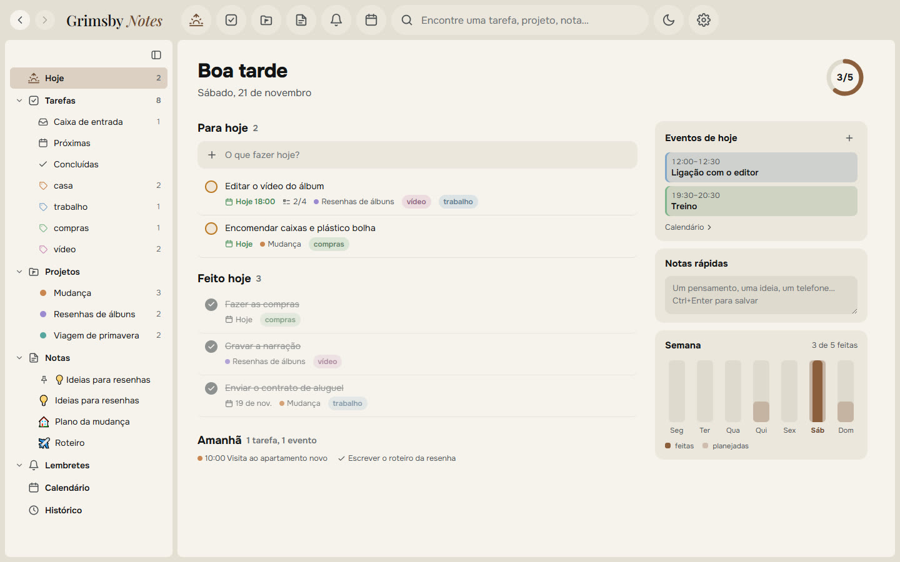

  <a href="README.md">English</a> ·
  <a href="README.ru.md">Русский</a> ·
  <a href="README.es.md">Español</a> ·
  <b>Português</b> ·
  <a href="README.de.md">Deutsch</a> ·
  <a href="README.fr.md">Français</a> ·
  <a href="README.zh.md">中文</a> ·
  <a href="README.ja.md">日本語</a> ·
  <a href="README.ko.md">한국어</a>

  

  <b>Um planejador pessoal para Windows: tarefas, projetos, notas e calendário numa janela.</b> 
  Tudo fica no seu computador: tarefas em lista, quadro ou numa tela livre, projetos com objetivos, notas ligadas e lembretes com notificações do Windows.

  
  
  
  
  

  <a href="https://github.com/maksimkhatskevich/grimsby-notes/releases/latest"><b>⬇ Baixar para Windows</b></a>
  &nbsp;·&nbsp;
  <a href="#recursos">Recursos</a>
  &nbsp;·&nbsp;
  <a href="#privacidade">Privacidade</a>
  &nbsp;·&nbsp;
  <a href="#contato">Contato</a>

---

## Por que o Grimsby Notes

Tarefas num app, notas em outro, calendário num terceiro — e metade pede conta e internet. Um plano simples para o dia acaba espalhado por vários serviços.

**O Grimsby Notes mantém tudo junto e em casa.** Uma janela, um arquivo de banco de dados no seu computador, sem contas. Abra **Hoje** e veja o que está atrasado, o que está planejado e o que já foi feito.

---

## Recursos

### ☀️ Hoje

Tarefas atrasadas e planejadas, eventos do dia, notas rápidas e um anel de progresso da semana. Adicione uma tarefa ali mesmo numa linha: datas como 25.12, hora, !prioridade, #tags e @projeto são reconhecidos enquanto você digita.

### ✅ Tarefas: lista e quadro

Caixa de entrada, próximas e concluídas, filtros e visualizações salvas. Um quadro com colunas e cores próprias. Cada tarefa tem prazo e hora, prioridade, tags, checklist, descrição, anexos com prévia de fotos e vídeos, repetições e lembretes. Uma tarefa pode estar em vários projetos.

### 🎨 Tela

Um quadro livre onde as tarefas são organizadas por áreas de projeto: mova um cartão para uma área e ele entra no projeto; coloque onde duas áreas se cruzam e ele pertence a ambos. Zonas neutras, texto, setas, formas, imagens e conectores entre tarefas. Compartilhe a tela inteira ou a parte visível em PNG ou PDF.

### 📁 Projetos

Objetivo, status, prazo e progresso. A aba **Sobre o projeto** guarda por que ele existe, o resultado esperado, critérios de conclusão com caixas de seleção, datas-chave e links. Cada projeto tem seu quadro e suas notas; os concluídos vão para o arquivo.

### 📝 Notas

Um editor em blocos com barra de formatação: títulos, listas, checklists, tabelas, imagens, código e citações, fontes, tamanhos, cores e alinhamento. Páginas aninhadas, [[links]] para notas, tarefas e projetos, links reversos, modelos, seções, arquivo e lixeira. Exportação para Markdown.

### 📅 Calendário e lembretes

Dia, semana e mês, eventos com repetições e cores, tarefas com prazo na mesma grade. Lembretes com listas, grupos e blocos. Notificações do Windows com **Concluído** e **Depois**, e um modo em segundo plano que avisa mesmo com a janela fechada.

🌍 **9 idiomas:** inglês, russo, espanhol, português, alemão, francês, chinês, japonês e coreano — troque nas Configurações, muda na hora.

O tema claro fica a um clique — o botão do sol, no alto.

---

## Baixar e instalar

1. Abra a página da **[versão mais recente](https://github.com/maksimkhatskevich/grimsby-notes/releases/latest)** e baixe o instalador `.exe`.
2. Execute-o. O Windows pode mostrar uma janela azul «O Windows protegeu o computador» — é um aviso normal para programas sem certificado de assinatura pago. Clique em **Mais informações → Executar assim mesmo**.
   O instalador foi verificado no VirusTotal: [nenhum dos 67 antivírus encontrou nada](https://www.virustotal.com/gui/file/8cb8169d20871ca6ab8770230a99f93bde22d5c3a665340b5c1b44a92f20507f) (versão 1.0.0).
3. Abra **Hoje** e digite sua primeira tarefa na linha do topo.

**Requisitos:** Windows 10 ou 11 (64 bits). A internet só é necessária para verificar atualizações.

---

## Privacidade

O Grimsby Notes funciona no seu computador. Tarefas, notas e anexos ficam lá num único arquivo de banco de dados, com um backup diário ao lado. Sem contas, sem servidores de sincronização, sem anúncios, sem análises. O app só se conecta para verificar atualizações (dá para desativar); links das notas abrem no navegador só com Ctrl+clique.

---

## Os apps Grimsby

<table>
  <tr>
    <td align="center" width="25%"><a href="https://github.com/maksimkhatskevich/grimsby-releases/blob/main/README.pt.md"> <b>Grimsby Player</b></a> Player offline para suas músicas e clipes baixados</td>
    <td align="center" width="25%"><a href="https://github.com/maksimkhatskevich/grimsby-converter/blob/main/README.pt.md"> <b>Grimsby Converter</b></a> Vídeo, áudio, fotos e documentos convertidos offline</td>
    <td align="center" width="25%"><a href="https://github.com/maksimkhatskevich/grimsby-tagger/blob/main/README.pt.md"> <b>Grimsby Tagger</b></a> Editor de tags em lote: álbuns, capas, nomes de arquivos</td>
    <td align="center" width="25%"><a href="https://github.com/maksimkhatskevich/grimsby-prompter/blob/main/README.pt.md"> <b>Grimsby Prompter</b></a> Um teleprompter simples que acompanha sua voz</td>
  </tr>
  <tr>
    <td align="center" width="25%"><a href="https://github.com/maksimkhatskevich/grimsby-helper/blob/main/README.pt.md"> <b>Grimsby Helper</b></a> A saúde do PC de relance: processos, temperaturas, limpeza</td>
    <td align="center" width="25%"><a href="https://github.com/maksimkhatskevich/grimsby-studio/blob/main/README.pt.md"> <b>Grimsby Studio</b></a> Editor de vídeo com inserções musicais animadas</td>
    <td align="center" width="25%"> <b>Grimsby Notes</b> </td>
  </tr>
</table>

---

## Contato

Encontrou um erro, tem uma ideia ou só quer agradecer? Escreva:

- ✉️ e-mail: **[grimsbyy@gmail.com](mailto:grimsbyy@gmail.com)**
- 🐞 erros e ideias: [Issues](https://github.com/maksimkhatskevich/grimsby-notes/issues)
- 📣 Telegram: [@itsgrimsby](https://t.me/itsgrimsby) (em russo)

---

## Licenças

O Grimsby Notes usa componentes de código aberto, incluindo Electron e React, e as fontes Onest e Playfair Display. A lista completa com os textos das licenças está em `THIRD_PARTY_NOTICES.txt`, na pasta do programa.

© 2026 Grimsby

