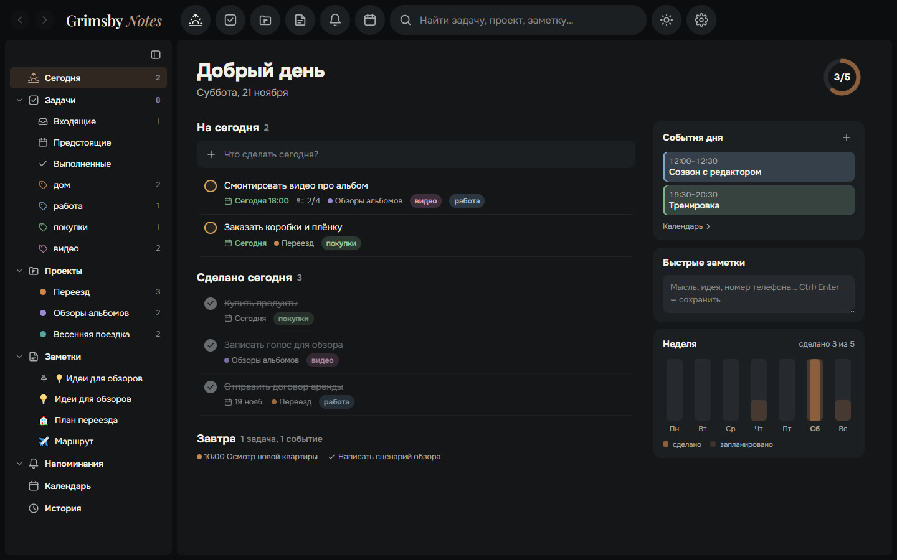
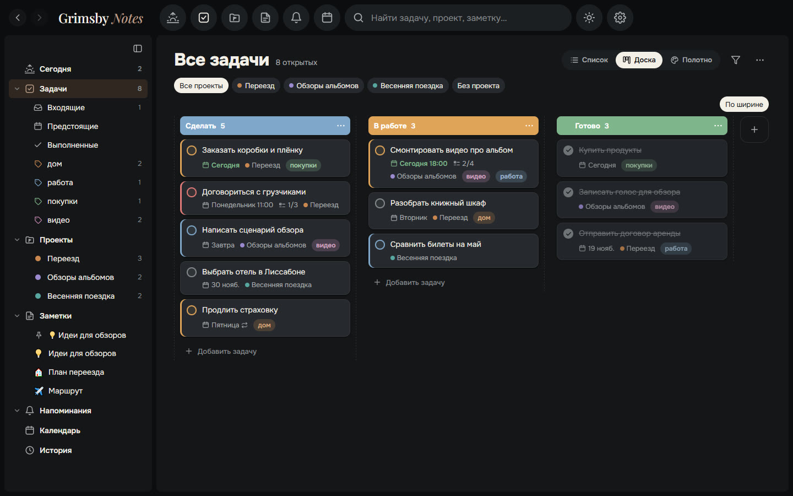
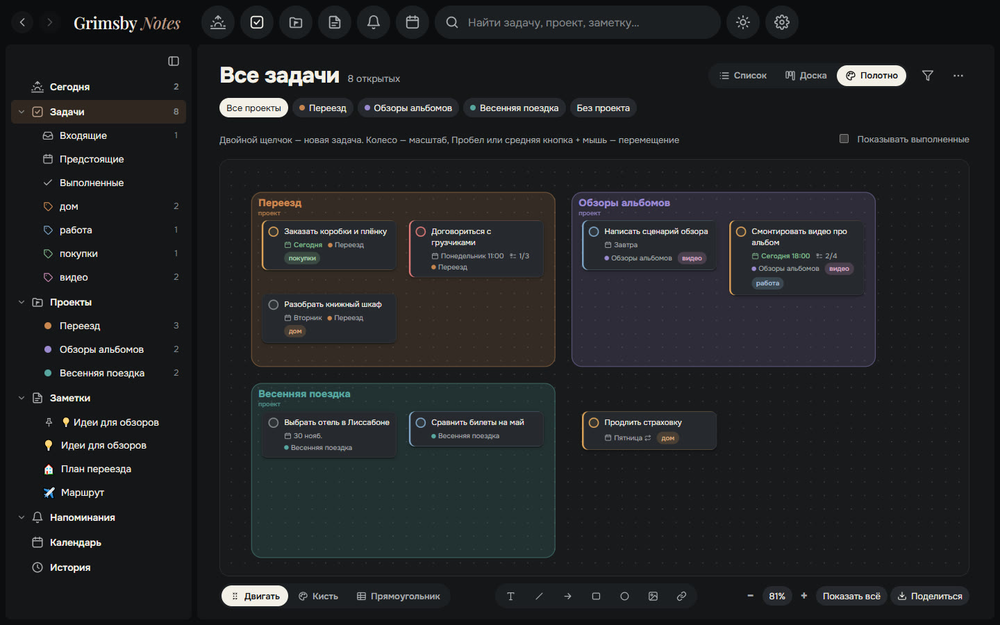
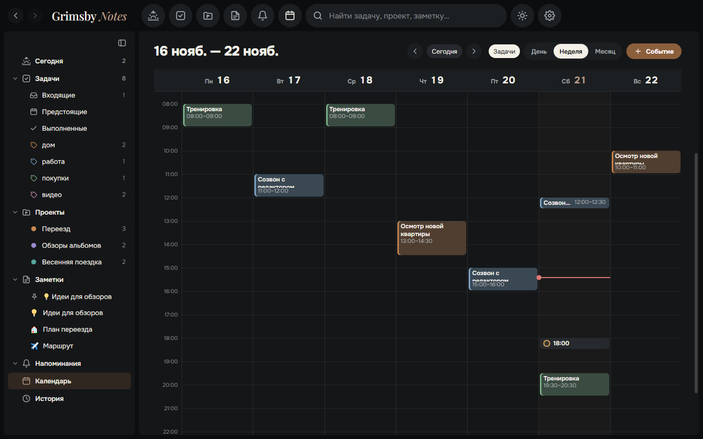
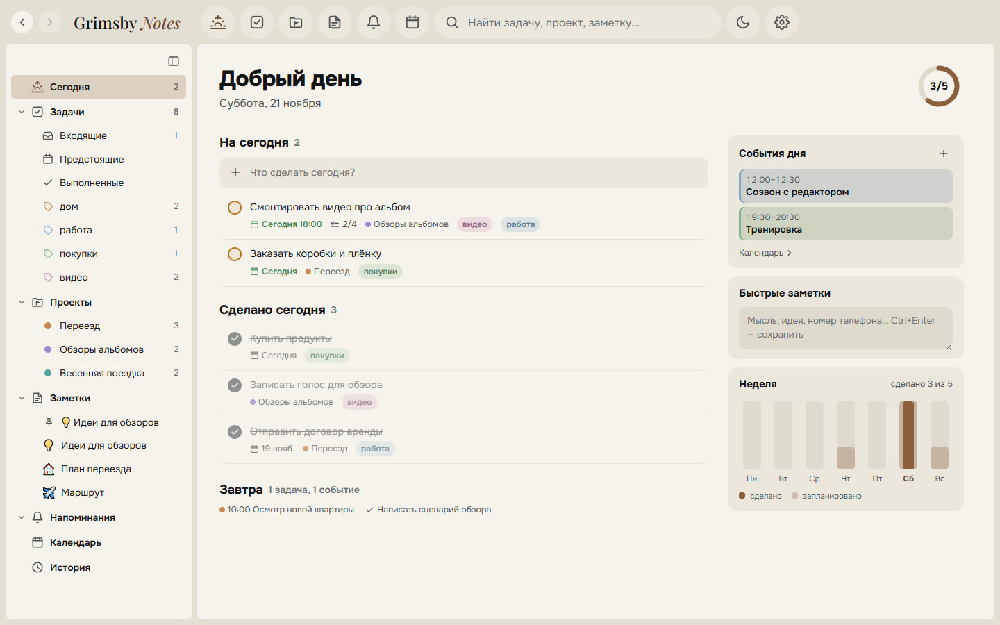

  <a href="README.md">English</a> ·
  <b>Русский</b> ·
  <a href="README.es.md">Español</a> ·
  <a href="README.pt.md">Português</a> ·
  <a href="README.de.md">Deutsch</a> ·
  <a href="README.fr.md">Français</a> ·
  <a href="README.zh.md">中文</a> ·
  <a href="README.ja.md">日本語</a> ·
  <a href="README.ko.md">한국어</a>

  

  <b>Личный планировщик для Windows: задачи, проекты, заметки и календарь в одном окне.</b> 
  Всё хранится на вашем компьютере: задачи списком, доской или на свободном полотне, проекты с целями, связанные заметки, напоминания с уведомлениями Windows.

  
  
  
  
  

  <a href="https://github.com/maksimkhatskevich/grimsby-notes/releases/latest"><b>⬇ Скачать для Windows</b></a>
  &nbsp;·&nbsp;
  <a href="#возможности">Возможности</a>
  &nbsp;·&nbsp;
  <a href="#приватность">Приватность</a>
  &nbsp;·&nbsp;
  <a href="#обратная-связь">Обратная связь</a>

---

## Зачем Grimsby Notes

Задачи в одной программе, заметки в другой, календарь в третьей — и половине из них нужен аккаунт и интернет. Простой план на день расползается по сервисам.

**Grimsby Notes держит всё вместе и дома.** Одно окно, один файл базы на вашем компьютере, без аккаунтов. Откройте **«Сегодня»** — и видно, что горит, что запланировано и что уже сделано.

---

## Возможности

### ☀️ Сегодня

Просроченное и план на день, события дня, быстрые заметки и кольцо прогресса недели. Задача добавляется прямо здесь одной строкой: даты вроде 25.12, время, !приоритет, #метки и @проект распознаются на ходу.

### ✅ Задачи: список и доска

«Входящие», «Предстоящие» и «Выполненные», фильтры и сохранённые виды. Доска со своими колонками и цветами. У задачи — срок и время, приоритет, метки, чек-лист, описание, вложения с просмотром фото и видео, повторы и напоминания. Задача может быть сразу в нескольких проектах.

### 🎨 Полотно

Свободная доска, где задачи раскладываются по областям проектов: перенесите карточку в область — задача попадёт в проект; положите на пересечение двух областей — будет в обоих. Нейтральные зоны, текст, стрелки, фигуры, картинки и соединители между задачами. Поделиться всем полотном или видимой частью в PNG или PDF.

### 📁 Проекты

Цель, статус, срок и прогресс. Вкладка **«О проекте»** хранит, зачем он нужен, ожидаемый результат, критерии готовности с галочками, ключевые даты и ссылки. У каждого проекта своя доска и заметки; завершённые уходят в архив.

### 📝 Заметки

Блочный редактор с панелью оформления: заголовки, списки, чек-листы, таблицы, картинки, код и цитаты, шрифты, размеры, цвета и выравнивание. Вложенные страницы, ссылки [[на заметки, задачи и проекты]], обратные ссылки, шаблоны, разделы, архив и корзина. Экспорт в Markdown.

### 📅 Календарь и напоминания

День, неделя и месяц, события с повторами и цветами, задачи со сроком прямо в сетке. Напоминания со списками, группами и плитками. Уведомления Windows с кнопками **«Готово»** и **«Позже»** и фоновый режим, который напомнит, даже когда окно закрыто.

🌍 **9 языков:** русский, английский, испанский, португальский, немецкий, французский, китайский, японский и корейский — переключаются в настройках сразу.

Светлая тема — в один клик, кнопка с солнцем вверху.

---

## Скачать и установить

1. Откройте страницу **[последней версии](https://github.com/maksimkhatskevich/grimsby-notes/releases/latest)** и скачайте установщик `.exe`.
2. Запустите его. Windows может показать синее окно «Система Windows защитила ваш компьютер» — это обычное предупреждение для программ без платного сертификата подписи. Нажмите **Подробнее → Выполнить в любом случае**.
   Установщик проверен на VirusTotal: [ни один из 67 антивирусов ничего не нашёл](https://www.virustotal.com/gui/file/8cb8169d20871ca6ab8770230a99f93bde22d5c3a665340b5c1b44a92f20507f) (версия 1.0.0).
3. Откройте **«Сегодня»** и впишите первую задачу в строку сверху.

**Требования:** Windows 10 или 11 (64 бит). Интернет нужен только чтобы проверить обновления.

---

## Приватность

Grimsby Notes работает на вашем компьютере. Задачи, заметки и вложения хранятся там в одном файле базы, рядом — ежедневная резервная копия. Без аккаунтов, серверов синхронизации, рекламы и аналитики. В интернет программа выходит, только чтобы проверить обновления (можно выключить); ссылки из заметок открываются в браузере только по Ctrl+щелчку.

---

## Программы Grimsby

<table>
  <tr>
    <td align="center" width="25%"><a href="https://github.com/maksimkhatskevich/grimsby-releases/blob/main/README.ru.md"> <b>Grimsby Player</b></a> Офлайн-плеер для скачанной музыки и клипов</td>
    <td align="center" width="25%"><a href="https://github.com/maksimkhatskevich/grimsby-converter/blob/main/README.ru.md"> <b>Grimsby Converter</b></a> Видео, аудио, фото и документы — конвертация без интернета</td>
    <td align="center" width="25%"><a href="https://github.com/maksimkhatskevich/grimsby-tagger/blob/main/README.ru.md"> <b>Grimsby Tagger</b></a> Пакетный редактор тегов: альбомы, обложки, имена файлов</td>
    <td align="center" width="25%"><a href="https://github.com/maksimkhatskevich/grimsby-prompter/blob/main/README.ru.md"> <b>Grimsby Prompter</b></a> Простой телесуфлёр, который следует за голосом</td>
  </tr>
  <tr>
    <td align="center" width="25%"><a href="https://github.com/maksimkhatskevich/grimsby-helper/blob/main/README.ru.md"> <b>Grimsby Helper</b></a> Состояние ПК с первого взгляда: процессы, температуры, чистка</td>
    <td align="center" width="25%"><a href="https://github.com/maksimkhatskevich/grimsby-studio/blob/main/README.ru.md"> <b>Grimsby Studio</b></a> Видеоредактор с анимированными музыкальными вставками</td>
    <td align="center" width="25%"> <b>Grimsby Notes</b> </td>
  </tr>
</table>

---

## Обратная связь

Нашли ошибку, есть идея или просто хотите сказать спасибо? Пишите:

- ✉️ почта: **[grimsbyy@gmail.com](mailto:grimsbyy@gmail.com)**
- 🐞 ошибки и идеи: [Issues](https://github.com/maksimkhatskevich/grimsby-notes/issues)
- 📣 Telegram: [@itsgrimsby](https://t.me/itsgrimsby)

---

## Лицензии

Grimsby Notes использует компоненты с открытым кодом, в том числе Electron и React, и шрифты Onest и Playfair Display. Полный список с текстами лицензий — в файле `THIRD_PARTY_NOTICES.txt` в папке программы.

© 2026 Grimsby

