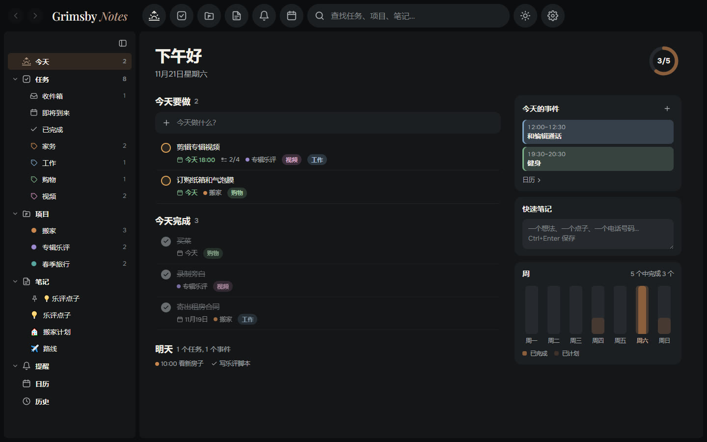
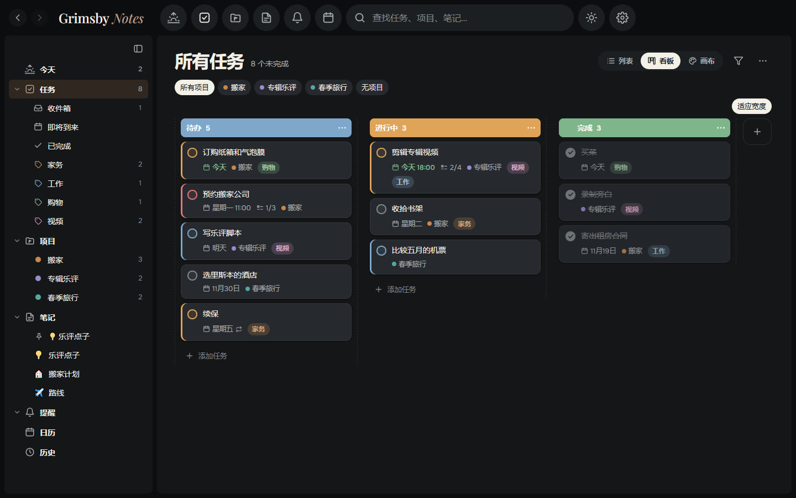
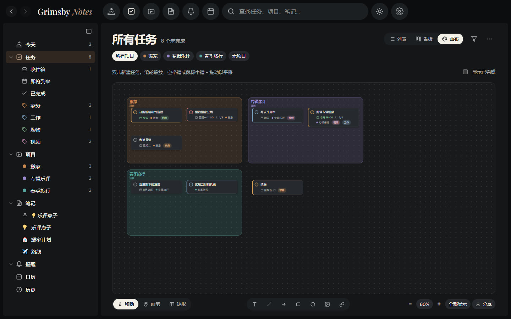
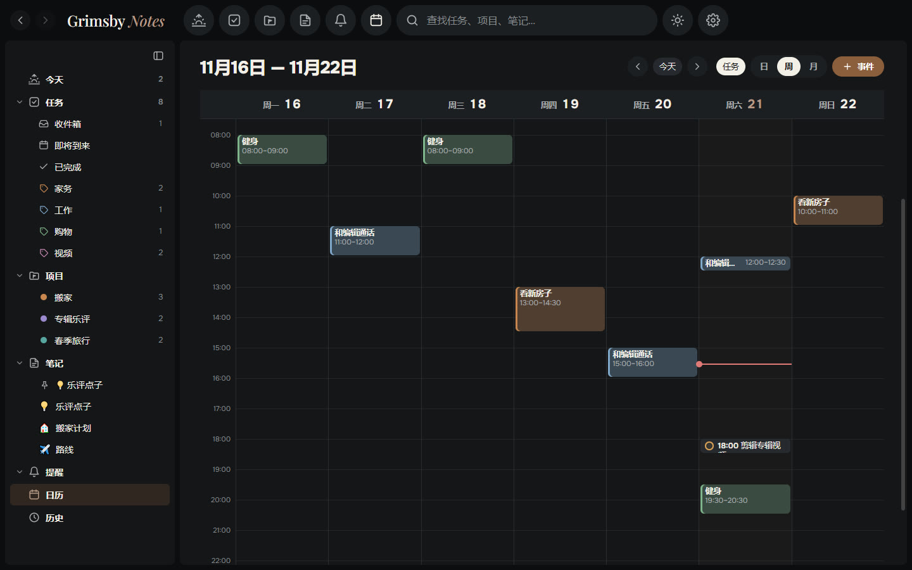
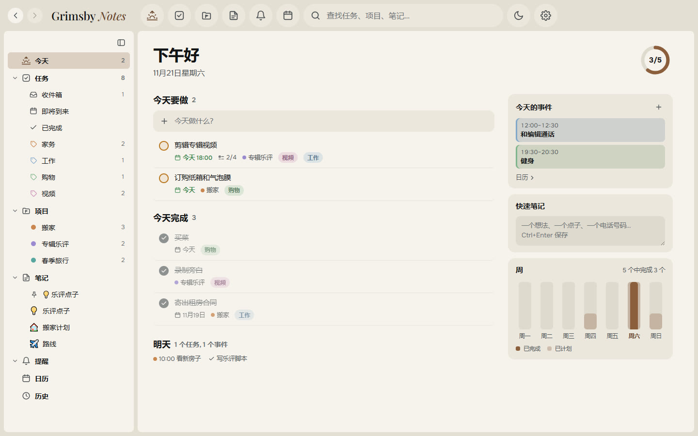

  <a href="README.md">English</a> ·
  <a href="README.ru.md">Русский</a> ·
  <a href="README.es.md">Español</a> ·
  <a href="README.pt.md">Português</a> ·
  <a href="README.de.md">Deutsch</a> ·
  <a href="README.fr.md">Français</a> ·
  <b>中文</b> ·
  <a href="README.ja.md">日本語</a> ·
  <a href="README.ko.md">한국어</a>

  

  <b>Windows 个人规划工具：任务、项目、笔记和日历，一个窗口全搞定。</b> 
  一切都保存在你的电脑上：任务可用列表、看板或自由画布管理，项目有目标，笔记互相链接，提醒通过 Windows 通知送达。

  
  
  
  
  

  <a href="https://github.com/maksimkhatskevich/grimsby-notes/releases/latest"><b>⬇ 下载 Windows 版</b></a>
  &nbsp;·&nbsp;
  <a href="#功能">功能</a>
  &nbsp;·&nbsp;
  <a href="#隐私">隐私</a>
  &nbsp;·&nbsp;
  <a href="#反馈">反馈</a>

---

## 为什么选择 Grimsby Notes

任务在一个软件里，笔记在另一个，日历又在第三个——其中一半还要账号和网络。一份简单的当天计划被拆散在各种服务里。

**Grimsby Notes 把一切放在一起，留在本地。** 一个窗口，电脑上一个数据库文件，无需账号。打开 **今天**，就能看到哪些到期、哪些已计划、哪些已完成。

---

## 功能

### ☀️ 今天

逾期和计划中的任务、当天的日程、快速笔记和本周进度环。直接在这里用一行添加任务：25.12 这样的日期、时间、!优先级、#标签和 @项目会在输入时识别。

### ✅ 任务：列表和看板

收件箱、即将到来和已完成，筛选和保存的视图。看板可自定列和颜色。每个任务都有截止日期和时间、优先级、标签、清单、描述、可预览照片和视频的附件、重复和提醒。一个任务可以同时属于多个项目。

### 🎨 画布

自由的画布，任务按项目区域摆放：把卡片拖进某个区域，它就加入该项目；放在两个区域重叠处，就同时属于两个项目。中立区、文字、箭头、形状、图片和任务间的连接线。可把整个画布或可见部分分享为 PNG 或 PDF。

### 📁 项目

目标、状态、截止日期和进度。**关于项目** 标签页记录项目的意义、预期结果、可勾选的完成标准、关键日期和链接。每个项目都有自己的看板和笔记；完成的项目进入归档。

### 📝 笔记

带格式工具栏的块编辑器：标题、列表、清单、表格、图片、代码和引用，字体、字号、颜色和对齐。嵌套页面、指向笔记、任务和项目的 [[链接]]、反向链接、模板、分区、归档和回收站。可导出为 Markdown。

### 📅 日历和提醒

日、周、月视图，带重复和颜色的日程，有截止日期的任务直接显示在网格中。提醒支持列表、分组和磁贴。Windows 通知带 **完成** 和 **稍后** 按钮，后台模式在窗口关闭时也能提醒。

🌍 **9 种语言：** 英语、俄语、西班牙语、葡萄牙语、德语、法语、中文、日语和韩语——在设置中切换，立即生效。

浅色主题一键切换——顶部的太阳按钮。

---

## 下载与安装

1. 打开 **[最新版本](https://github.com/maksimkhatskevich/grimsby-notes/releases/latest)** 页面，下载安装程序 `.exe`。
2. 运行它。Windows 可能会显示蓝色的“Windows 已保护你的电脑”窗口——这是没有付费代码签名证书的程序的正常提示。点击 **更多信息 → 仍要运行**。
   安装程序已在 VirusTotal 上检测：[67 款杀毒引擎均未发现问题](https://www.virustotal.com/gui/file/8cb8169d20871ca6ab8770230a99f93bde22d5c3a665340b5c1b44a92f20507f)（1.0.0 版）。
3. 打开 **今天**，在顶部的输入行写下第一个任务。

**系统要求：** Windows 10 或 11（64 位）。

---

## 隐私

Grimsby Notes 在你的电脑上运行。任务、笔记和附件都保存在本机的一个数据库文件里，旁边还有每日备份。没有账号、没有同步服务器、没有广告、没有统计。软件只在检查更新时联网（可关闭）；笔记中的链接只有按 Ctrl+单击才会在浏览器中打开。

---

## Grimsby 应用

<table>
  <tr>
    <td align="center" width="25%"><a href="https://github.com/maksimkhatskevich/grimsby-releases/blob/main/README.zh.md"> <b>Grimsby Player</b></a> 为你下载的音乐和 MV 打造的离线播放器</td>
    <td align="center" width="25%"><a href="https://github.com/maksimkhatskevich/grimsby-converter/blob/main/README.zh.md"> <b>Grimsby Converter</b></a> 视频、音频、照片和文档，离线转换</td>
    <td align="center" width="25%"><a href="https://github.com/maksimkhatskevich/grimsby-tagger/blob/main/README.zh.md"> <b>Grimsby Tagger</b></a> 批量标签编辑：专辑、封面、文件名</td>
    <td align="center" width="25%"><a href="https://github.com/maksimkhatskevich/grimsby-prompter/blob/main/README.zh.md"> <b>Grimsby Prompter</b></a> 会跟随你声音的简单提词器</td>
  </tr>
  <tr>
    <td align="center" width="25%"><a href="https://github.com/maksimkhatskevich/grimsby-helper/blob/main/README.zh.md"> <b>Grimsby Helper</b></a> 电脑状态一目了然：进程、温度、清理</td>
    <td align="center" width="25%"><a href="https://github.com/maksimkhatskevich/grimsby-studio/blob/main/README.zh.md"> <b>Grimsby Studio</b></a> 带动画音乐插段的视频编辑器</td>
    <td align="center" width="25%"> <b>Grimsby Notes</b> </td>
  </tr>
</table>

---

## 反馈

发现了问题、有想法，或者只是想说声谢谢？欢迎联系：

- ✉️ 邮箱: **[grimsbyy@gmail.com](mailto:grimsbyy@gmail.com)**
- 🐞 问题与建议: [Issues](https://github.com/maksimkhatskevich/grimsby-notes/issues)
- 📣 Telegram：[@itsgrimsby](https://t.me/itsgrimsby)（俄语）

---

## 许可证

Grimsby Notes 使用了开源组件，包括 Electron 和 React，以及 Onest 和 Playfair Display 字体。完整列表及许可证文本见程序文件夹中的 `THIRD_PARTY_NOTICES.txt`。

© 2026 Grimsby

